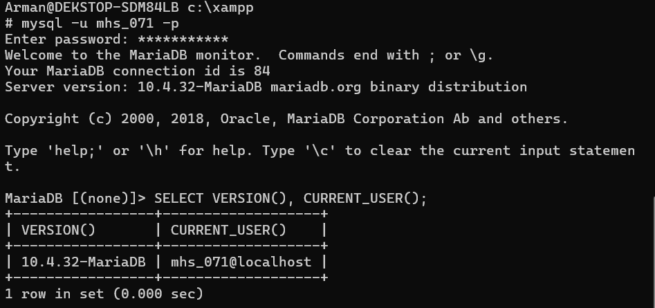
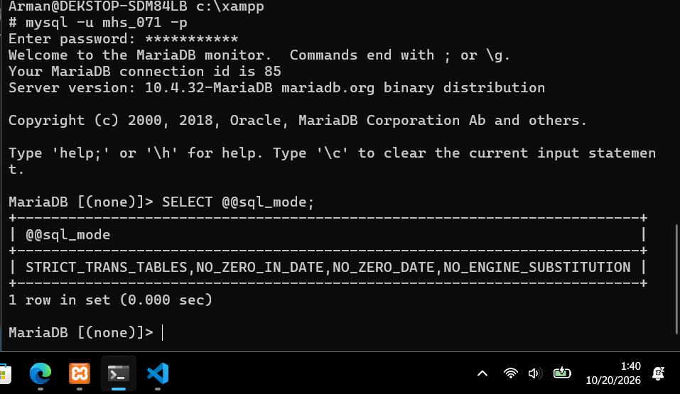
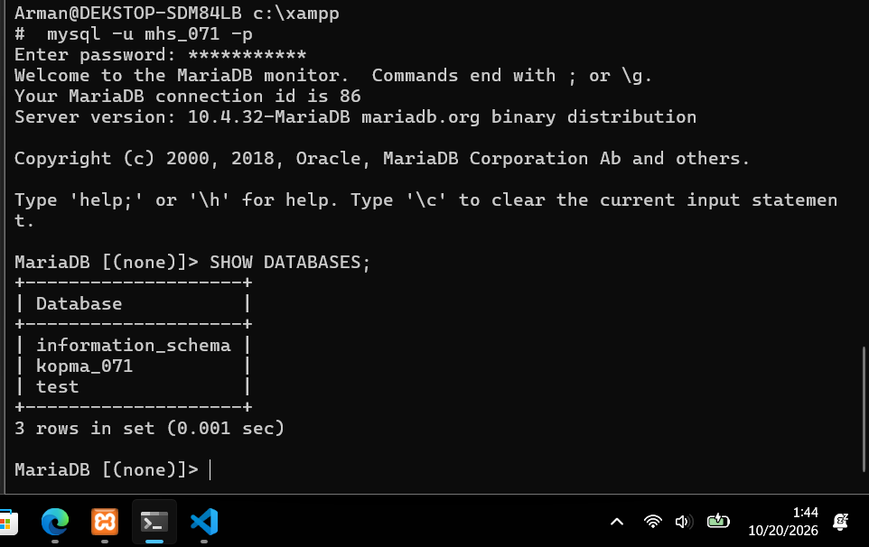
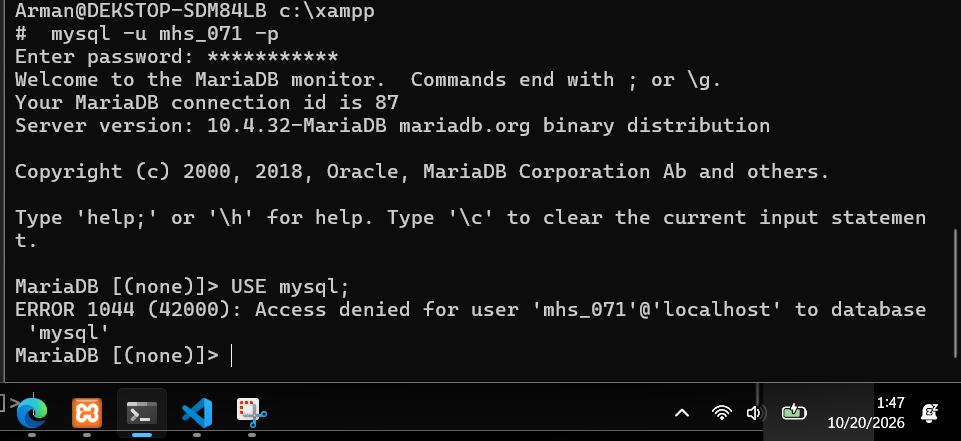
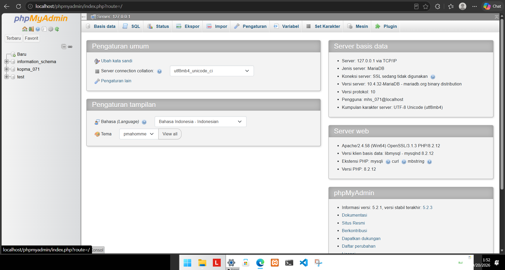
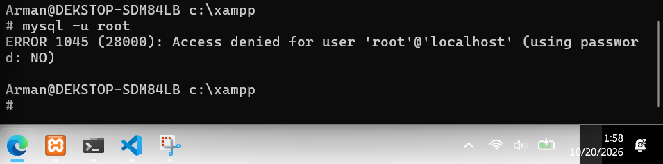
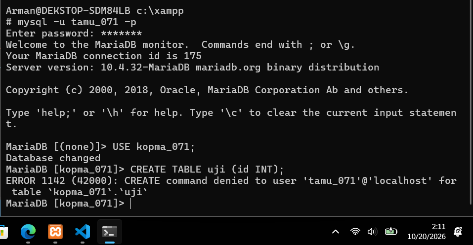
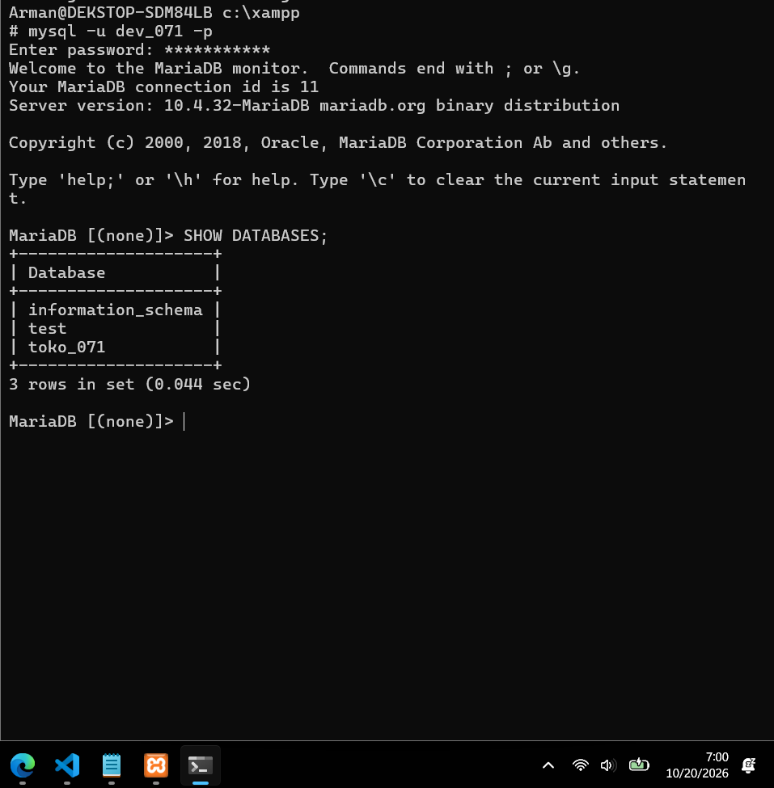
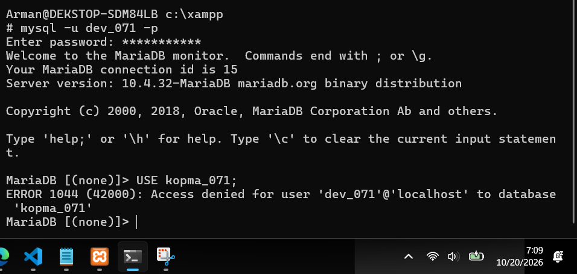
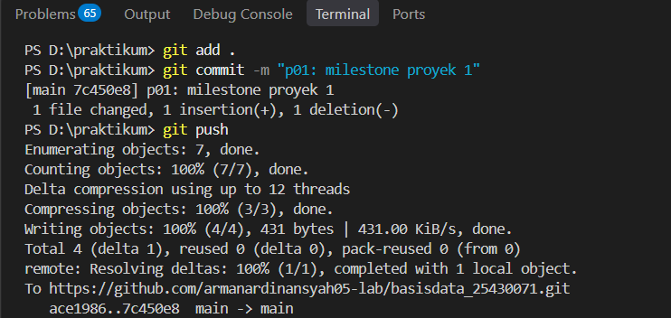

# Laporan Praktikum Basis Data - Pertemuan 1

**Identitas Mahasiswa**
* **Nama:** Arman Ardinansyah
* **NPM:** 25430071
* **Kelas:** C
* **Tanggal:** 4 Oktober 2026
* **Dosen Pengampu:** Dedi Irawan, S.Kom., M.T.I.

---

## 1. Tujuan Praktikum
* Menguasai cara mengoperasikan RDBMS MariaDB melalui layanan XAMPP secara CLI dan GUI.
* Memahami cara mengamankan akun administrator (`root`) dan mengimplementasikan prinsip *least privilege* dengan membuat akun kerja non-root (`mhs_071`).
* Mengerti pembuatan dan pengelolaan basis data serta konfigurasi SQL Mode di MariaDB.
* Menguasai penggunaan Git dan GitHub untuk manajemen repositori serta pengumpulan tugas praktikum secara terstruktur.

---

## 2. Ringkasan Dasar Teori

### Arsitektur Klien-Server MariaDB
MariaDB bekerja dengan model klien-server di mana proses utama bernama `mysqld` berjalan di latar belakang dan mendengarkan permintaan jaringan pada port default 3306. Aplikasi klien mengirimkan perintah SQL ke server `mysqld`, yang kemudian memproses data dan mengembalikan hasilnya ke klien.

### Klien CLI (`mysql`) vs Klien GUI (`phpMyAdmin`)
* **CLI (`mysql`)**: Memungkinkan interaksi langsung melalui konsol teks. Sangat ringan, cepat, dan ideal untuk eksekusi skrip otomatisasi serta konfigurasi server mendalam.
* **GUI (`phpMyAdmin`)**: Memberikan antarmuka berbasis web visual. Memudahkan pengguna dalam navigasi struktur tabel, visualisasi data, dan manajemen basis data tanpa perlu menghafal seluruh sintaks SQL.

### Prinsip *Least Privilege*
Prinsip *least privilege* menekankan bahwa setiap akun pengguna hanya boleh diberikan hak akses minimum yang benar-benar dibutuhkan untuk menyelesaikan tugasnya. Akun `root` yang memiliki akses penuh tidak boleh digunakan untuk kegiatan operasional sehari-hari guna menghindari kerusakan data yang tidak disengaja atau ancaman keamanan.

### Alur Kerja Git
Sistem kontrol versi Git membagi alur kerja menjadi tiga area utama:
1. **Working Directory:** Area kerja lokal tempat berkas dibuat atau diubah.
2. **Staging Area (`git add`):** Penampungan sementara untuk memilih perubahan berkas yang siap disimpan.
3. **Local Repository (`git commit`):** Perekaman perubahan data secara permanen ke dalam basis data lokal Git.
4. **Remote Repository (`git push`):** Pengunggahan commit lokal ke peladen jarak jauh seperti GitHub.

---

## 3. Hasil Langkah Percobaan

### 3.1 Verifikasi Versi dan Akun Masuk CLI
* **Perintah:**
  ```sql
  SELECT VERSION(), CURRENT_USER();
  ```
* **Tangkapan Layar:**
  

### 3.2 Verifikasi SQL Mode
* **Perintah:**
  ```sql
  SELECT @@sql_mode;
  ```
* **Tangkapan Layar:**
  

### 3.3 Menampilkan Daftar Basis Data Akun Kerja (`mhs_071`)
* **Perintah:**
  ```sql
  SHOW DATABASES;
  ```
* **Tangkapan Layar:**
  

### 3.4 Pengujian Batasan Akses Akun Kerja (`mhs_071`)
* **Perintah:**
  ```sql
  USE mysql;
  ```
* **Tangkapan Layar:**
  

### 3.5 Akses via phpMyAdmin Mode Cookie sebagai `mhs_071`
* **Tangkapan Layar Login & Tab SQL:**
  

---

## 4. Jawaban Titik Analisis

### Titik Analisis 1: Perbedaan Rujukan Dokumentasi MySQL dan MariaDB
Meskipun MariaDB merupakan turunan dari MySQL, terdapat perbedaan fitur, variabel konfigurasi, dan fungsi internal seiring perkembangannya. Jika menemukan galat, rujukan dokumentasi MariaDB resmi lebih tepat digunakan karena menangani implementasi mesin penyimpanan dan sintaksis spesifik MariaDB yang mungkin tidak didukung atau berbeda pada dokumentasi MySQL modern.

### Titik Analisis 2: Percobaan Masuk Tanpa Password (`mysql -u root`)
* **Tangkapan Layar Galat:**
  
* **Analisis `(using password: NO)`:**
  Pesan `ERROR 1045 (28000): Access denied for user 'root'@'localhost' (using password: NO)` menandakan bahwa server menolak autentikasi karena pengguna mencoba masuk tanpa mengirimkan kata sandi, sedangkan akun `root` telah diamankan dengan kata sandi.

### Titik Analisis 3: Akses `information_schema` vs Basis Data `mysql`
Akun `mhs_071` dapat mengakses `information_schema` karena basis data tersebut merupakan skema standar ANSI SQL yang menyediakan data struktur mengenai basis data. Semua pengguna terautentikasi berhak melihat data tersebut terkait objek yang boleh mereka akses. Sebaliknya, basis data `mysql` berisi data kredensial dan tabel privilese sistem yang bersifat krusial, sehingga aksesnya dibatasi hanya untuk akun administrator.

### Titik Analisis 4: Keamanan Mode `cookie` vs Mode `config` pada phpMyAdmin
Pada mode `config`, kata sandi disimpan dalam bentuk teks polos di dalam berkas `config.inc.php`, sehingga siapa pun yang memiliki akses baca ke server web dapat melihat kata sandi tersebut. Mode `cookie` meminta pengguna memasukkan nama pengguna dan kata sandi pada halaman login setiap kali sesi dimulai, lalu menyimpannya terenkripsi dalam data peramban. Hal ini jauh lebih aman karena kredensial tidak tersimpan permanen di server.

### Analisis Wajib Tambahan: Perbedaan Kode Galat 1044, 1045, dan 1142
* **`ERROR 1044`:** Terjadi saat proses login berhasil, tetapi pengguna tidak memiliki hak akses untuk memilih atau membuka basis data tertentu (misalnya perintah `USE mysql;` oleh `mhs_071`).
* **`ERROR 1045`:** Terjadi pada tahap awal autentikasi saat pengguna gagal login akibat nama pengguna tidak ditemukan, kata sandi salah, atau kata sandi tidak disertakan.
* **`ERROR 1142`:** Terjadi ketika pengguna sudah berhasil masuk dan menggunakan basis data, tetapi tidak memiliki izin untuk mengeksekusi perintah tertentu pada objek spesifik (misalnya perintah `CREATE TABLE` oleh `tamu_071`).

---

## 5. Hasil Latihan dan Modifikasi

### Pengujian Hak Akses Akun `tamu_071`
* **Sintaks Pembuatan & Pemberian Hak Akses:**
  ```sql
  CREATE USER 'tamu_071'@'localhost' IDENTIFIED BY 'tamu123';
  GRANT SELECT ON kopma_071.* TO 'tamu_071'@'localhost';
  FLUSH PRIVILEGES;
  ```
* **Pengujian Perintah DDL (`CREATE TABLE`):**
  

### Skrip Idempoten (`p01_lingkungan_25430071.sql`)
```sql
-- Skrip Idempoten Konfigurasi Lingkungan Praktikum
-- Mengecek sql_mode
SELECT @@sql_mode;

-- Membuat Database jika belum ada
CREATE DATABASE IF NOT EXISTS kopma_071 CHARACTER SET utf8mb4 COLLATE utf8mb4_unicode_ci;

-- Membuat User jika belum ada
CREATE USER IF NOT EXISTS 'mhs_071'@'localhost' IDENTIFIED BY '<PASSWORD>';

-- Memberikan Hak Akses
GRANT ALL PRIVILEGES ON kopma_071.* TO 'mhs_071'@'localhost';

FLUSH PRIVILEGES;
```

---

## 6. Tugas Mandiri: Milestone Proyek 1

### Basis Data dan Akun Proyek Toko Daring (`toko_071` / `dev_071`)
* **Sintaks Pembuatan Basis Data & Akun Proyek:**
  ```sql
  CREATE DATABASE IF NOT EXISTS toko_071 CHARACTER SET utf8mb4 COLLATE utf8mb4_unicode_ci;
  CREATE USER IF NOT EXISTS 'dev_071'@'localhost' IDENTIFIED BY 'password_dev_071';
  GRANT ALL PRIVILEGES ON toko_071.* TO 'dev_071'@'localhost';
  FLUSH PRIVILEGES;
  ```
* **Tangkapan Layar Akses Basis Data Proyek (`toko_071`):**
  

### Pengujian Batasan Akses Akun Proyek (`dev_071`)
* **Pengujian Perintah:**
  ```sql
  USE kopma_071;
  ```
* **Tangkapan Layar Penolakan Akses ke Basis Data Lain (`ERROR 1044`):**
  

### Dokumen `README.md` Proyek
```markdown
# Proyek Sistem Informasi Toko Daring (E-Commerce)

## Identitas Proyek
* **Tema Proyek:** Toko Daring
* **Nama Organisasi:** Toko Daring AA
* **Lingkup Layanan:** Sistem ini menyediakan layanan pengelolaan katalog produk, manajemen keranjang belanja pelanggan, pencatatan transaksi penjualan secara dalam jaringan, serta pemrosesan status pembayaran dan pengiriman barang.
```

### Berkas `.gitignore`
```text
# Mengabaikan berkas kredensial dan lingkungan
*.env
kredensial*.txt
*.log
.vscode/
```

---

## 7. Pembahasan dan Kendala
Selama pelaksanaan praktikum Modul 1, terdapat kendala teknis pada saat mengakses MariaDB pertama kali, yaitu port 3306 telah digunakan oleh layanan dari instalasi aplikasi lain. Kendala tersebut diselesaikan dengan menghentikan layanan yang berkonflik melalui pengelola layanan sistem operasi. Selain itu, pengaturan konfigurasi `phpMyAdmin` disesuaikan pada berkas `config.inc.php` dari mode penyimpanan terbuka (`config`) menjadi mode autentikasi manual (`cookie`) agar login meminta kredensial pengguna (`mhs_071`, `dev_071`, `tamu_071`) secara terpisah demi keamanan data proyek Toko Daring (`toko_071`).

---

## 8. Kesimpulan
Lingkungan kerja MariaDB dan konfigurasi basis data lokal `toko_071` telah berhasil dipasang dan diuji dengan baik. Implementasi hak akses pengguna sesuai prinsip *least privilege* (`mhs_071`, `tamu_071`, dan `dev_071`) serta integrasi kontrol versi menggunakan Git dan GitHub berjalan lancar, sehingga seluruh sistem siap digunakan untuk pengembangan basis data pada praktikum tahap berikutnya.

---

## 9. Pernyataan Penggunaan AI
Penggunaan asisten AI dalam modul ini dimanfaatkan untuk membantu menyusun struktur kerangka laporan Markdown dan memberikan rujukan mengenai perbedaan teknis kode galat MariaDB (`ERROR 1044`, `1045`, dan `1142`). Seluruh eksekusi perintah SQL, pengujian di lingkungan lokal, dan pengambilan tangkapan layar dilakukan secara mandiri oleh mahasiswa.

---

## 10. Bukti Git
 
* **Tautan Repositori:** `https://github.com/armanardinansyah05-lab/basisdata_25430071`
* **Hash Commit:** `7c450c8`
* **Pesan Commit:** `p01: inisialisasi repositori dan skrip lingkungan`

---

---

## Checklist Laporan Praktikum

### 1. Checklist Umum (Berlaku di Semua Pertemuan)

| Butir | Yang Harus Ada | Status |
|---|---|---|
| **Identitas** | Nama, NIM, kelas, pertemuan ke-N, tanggal pelaksanaan, nama asisten/dosen | [x] |
| **Tujuan** | Tujuan praktikum ditulis ulang dengan bahasa sendiri (maksimal 5 baris) | [x] |
| **Ringkasan teori** | Pemahaman sendiri atas Dasar Teori, maksimal setengah halaman, tanpa menyalin buku | [x] |
| **Langkah percobaan (D)** | Tangkapan layar hasil langkah kunci sesuai checklist khusus, masing-masing diberi keterangan singkat | [x] |
| **Titik Analisis** | Semua Titik Analisis dijawab lengkap dengan alasan, bukan sekadar ya/tidak | [x] |
| **Latihan (E)** | Skrip/dokumen hasil latihan beserta bukti berjalan | [x] |
| **Tugas Mandiri (F)** | Milestone proyek pertemuan ini: berkas, bukti, dan penjelasan keputusan desain | [x] |
| **Pembahasan dan kendala** | Galat yang ditemui, cara membacanya, dan cara mengatasinya | [x] |
| **Kesimpulan** | Dua sampai empat kalimat dengan bahasa sendiri | [x] |
| **Pernyataan Penggunaan AI** | Alat yang dipakai, untuk apa, bagian mana; tulis "tidak menggunakan" bila tidak memakai | [x] |
| **Bukti Git** | Tautan repositori dan kode *commit* (hash) pertemuan ini dengan pesan `pNN: ...` | [x] |
| **Keaslian** | Setiap tangkapan layar memperlihatkan akun ber-NIM dan jam sistem; nama objek memuat NIM/inisial | [x] |

---

### 2. Checklist Khusus Laporan Pertemuan 1


| Jenis | Yang Harus Ada | Status |
|---|---|---|
| **Berkas wajib** | `p01_lingkungan_25430071.sql` (dapat dijalankan ulang), `README.md` berisi Identitas Proyek, `.gitignore` | [x] |
| **Bukti tangkapan layar** | `SELECT VERSION(), CURRENT_USER();`; `SELECT @@sql_mode;`; `SHOW DATABASES` sebagai `mhs_071` dan `dev_071`; galat 1044 dan 1142; halaman masuk phpMyAdmin mode `cookie`; `git push` pertama | [x] |
| **Analisis wajib** | Titik Analisis 1–4; perbedaan kode galat 1044, 1045, dan 1142 | [x] |