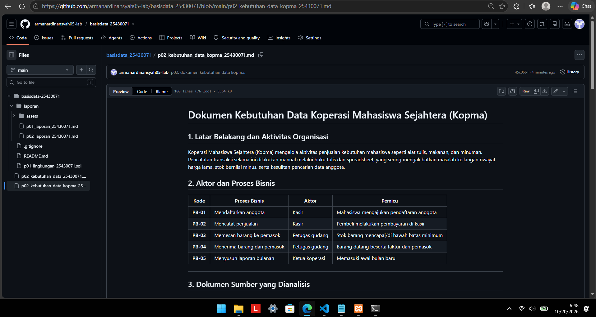
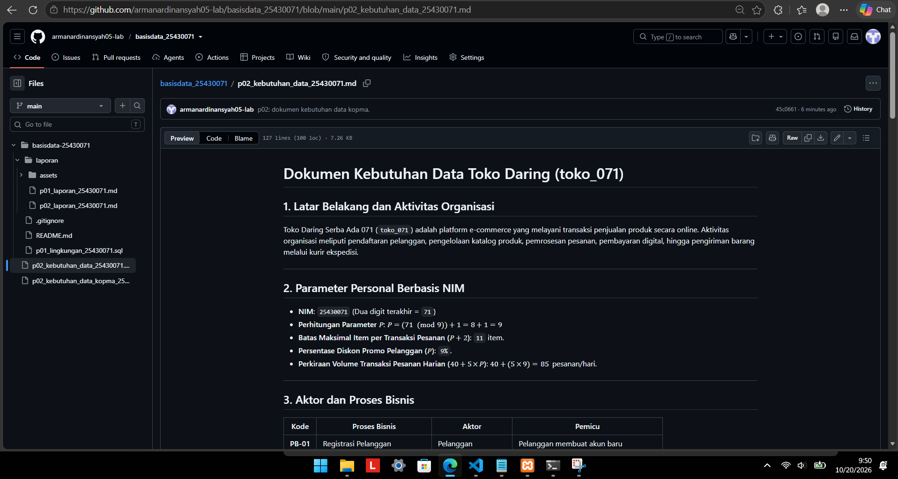

# Laporan Praktikum Basis Data - Pertemuan 2

**Nama:** Arman Ardinansyah  
**NPM:** 25430071  
**Kelas:** C  
**Tanggal:** 4 Oktober 2026  
**Dosen Pengampu:** Dedi Irawan, S.Kom., M.T.I.  

---

## 1. Tujuan Praktikum
* Mengidentifikasi aktivitas organisasi, aktor, serta proses bisnis dari narasi dan dokumen sumber.
* Menurunkan elemen data, entitas kandidat, dan aturan bisnis yang dapat diuji.
* Menyusun matriks proses-data (CRUD) serta kamus data awal yang dilengkapi penanggung jawab data.
* Menuliskan pernyataan kebutuhan data dan kebutuhan informasi yang terukur.

---

## 2. Ringkasan Dasar Teori
Analisis kebutuhan merupakan tahap pertama dalam perancangan basis data sebelum memasuki tahap desain konseptual, logis, dan fisik. Kesalahan yang terjadi pada tahap analisis merupakan kesalahan yang paling mahal untuk diperbaiki karena baru terdeteksi setelah struktur tabel dan data terlanjur dibuat. 

Pendekatan tata kelola data memandang data sebagai aset organisasi yang memiliki penanggung jawab (data steward), aturan bisnis, serta standar kualitas yang harus dijaga. Dokumen sumber seperti nota, formulir, atau kuitansi menjadi bahan utama pengidentifikasian elemen data. Pemetaan seluruh proses terhadap entitas dilakukan melalui matriks CRUD untuk memastikan tidak ada entitas yang dibuat tanpa pernah dibaca atau entitas yang tidak pernah di-create. Seluruh elemen data kemudian didokumentasikan ke dalam kamus data awal.

---

## 3. Hasil Langkah Percobaan
Langkah percobaan dilakukan dengan menganalisis studi kasus Koperasi Mahasiswa Sejahtera (Kopma) dan menyusun hasilnya ke dalam berkas `p02_kebutuhan_data_kopma_25430071.md`. Berkas tersebut mencakup:
1. Identifikasi 5 proses bisnis utama (PB-01 s.d. PB-05) beserta pemicunya.
2. Pembedahan dokumen sumber Nota Penjualan Kopma.
3. Penyusunan 8 entitas kandidat, 6 aturan bisnis (AB-01 s.d. AB-06), serta 4 kebutuhan informasi (KI-01 s.d. KI-04).
4. Penyusunan Matriks CRUD dan Kamus Data Awal yang memuat penanggung jawab data.

  
*Gambar 3.1 Tampilan dokumen p02_kebutuhan_data_kopma_25430071.md di GitHub*

---

## 4. Jawaban Titik Analisis
* **Titik Analisis 1**: Harga barang pada nota transaksi tetap harus disimpan di tabel detail penjualan meskipun harga barang sudah ada di tabel master barang. Hal ini disebabkan harga master barang dapat mengalami perubahan atau kenaikan di masa mendatang. Jika nota transaksi tidak menyimpan harga saat kejadian, maka laporan keuangan dan omzet historis masa lalu akan berubah ikut naik secara tidak valid.
* **Titik Analisis 2**: Subtotal dan total nilai belanja merupakan nilai turunan.
  * *Alasan tidak menyimpan*: Mencegah terjadinya anomali inkonsistensi data jika terdapat perubahan pada kuantitas atau harga per unit.
  * *Alasan menyimpan*: Mempercepat pemrosesan kueri pembacaan laporan tanpa perlu menghitung ulang (*re-calculate*) seluruh baris rincian barang pada transaksi dalam jumlah besar.
* **Titik Analisis 3**: Pada matriks CRUD Kopma, entitas Pemasok tidak memiliki huruf C (Create). Hal ini menandakan adanya proses bisnis yang terlewat, yaitu proses pendaftaran atau pendataan pemasok baru. Proses bisnis pendaftaran pemasok tersebut wajib ditambahkan ke dalam daftar proses bisnis agar entitas Pemasok dapat dibuat.

---

## 5. Hasil Latihan dan Modifikasi

### 1. Skema Poin Loyalitas Kopma
* **Elemen Data Baru**: `poin_anggota` pada entitas Anggota.
* **Aturan Bisnis Baru (AB-07)**: Setiap kelipatan belanja Rp10.000, anggota aktif memperoleh 1 poin. Sebanyak 50 poin dapat ditukarkan dengan potongan belanja Rp5.000.
* **Kebutuhan Informasi Baru (KI-05)**: Laporan rekapitulasi poin loyalitas per anggota.
* **Pembaruan Matriks CRUD**: Proses `PB-02` (Mencatat Penjualan) melakukan pembaruan Update (**U**) pada entitas Anggota untuk penambahan atau penukaran poin.

### 2. Perbaikan Pernyataan Kebutuhan Kabur
* **(a) "data anggota harus aman"**  
  * *Perbaikan*: Hak akses terhadap nomor telepon anggota dibatasi hanya untuk Ketua Koperasi dan wajib disembunyikan dari tampilan layar kasir.
* **(b) "sistem harus cepat mencari barang"**  
  * *Perbaikan*: Kueri pencarian data barang berdasarkan kode atau nama barang wajib menampilkan hasil dalam waktu kurang dari 2 detik.
* **(c) "laporan stok harus akurat"**  
  * *Perbaikan*: Sisa stok barang diperbarui secara *real-time* setiap kali transaksi penjualan atau penerimaan barang dari pemasok berhasil diproses.

---

## 6. Tugas Mandiri: Milestone Proyek 2
Tugas mandiri dikerjakan sesuai tema berdasarkan NIM `25430071` (dua digit akhir `71` = **Toko Daring**). Dokumen disusun dalam berkas `p02_kebutuhan_data_25430071.md`.

### Parameter Personal Berbasis NIM
* **NIM**: `25430071`
* **Parameter $P$**: $(71 \pmod 9) + 1 = \mathbf{9}$
* **Batas Maksimal Item/Transaksi ($P + 2$)**: `11` item
* **Diskon Promo Pelanggan ($P\%$)**: `9%`
* **Volume Transaksi Harian ($40 + 5 \times P$)**: $40 + (5 \times 9) = \mathbf{85}$ pesanan/hari

### Ringkasan Isi Dokumen Proyek Toko Daring (`toko_071`)
1. **Proses Bisnis (5 PB)**: Registrasi Pelanggan, Pengelolaan Katalog, Pemrosesan Pesanan, Pengiriman Barang, Penyusunan Laporan.
2. **Entitas Kandidat (6 Entitas)**: Pelanggan, Produk, Pesanan, Detail Pesanan, Kurir, Pembayaran.
3. **Aturan Bisnis (8 AB)**: Termasuk batasan maksimal 11 item per invoice, diskon 9%, stok tidak boleh negatif, serta rekaman harga saat *checkout*.
4. **Kebutuhan Informasi (5 KI)**: Laporan omzet, 5 produk terlaris, produk stok habis, 10 pelanggan terbanyak belanja, dan rekap kurir.
5. **Kamus Data**: Terdiri dari 20 elemen data yang dilengkapi tipe, format, dan kolom penanggung jawab data.
6. **Dokumen Sumber**: Pembedahan Invoice Pesanan Online Toko Daring.

  
*Gambar 6.1 Tampilan dokumen p02_kebutuhan_data_25430071.md di GitHub*

---

## 7. Pembahasan dan Kendala
Dalam menyusun dokumen kebutuhan data, kendala utama yang dihadapi adalah menentukan apakah harga barang pada riwayat pesanan perlu disimpan tersendiri atau cukup merujuk pada tabel produk. Setelah menganalisis dampak historis naik-turunnya harga barang, diputuskan bahwa harga barang wajib dicatat pada entitas detail pesanan saat *checkout* dilakukan agar laporan omzet masa lalu tetap konsisten. Selain itu, penetapan kolom penanggung jawab data pada kamus data membantu memperjelas wewenang pengelolaan data pribadi pelanggan seperti nomor HP dan alamat pengiriman.

---

## 8. Kesimpulan
Tahap analisis kebutuhan data memberikan pemahaman mendalam mengenai seluruh aset data organisasi, pemicu bisnis, serta aturan yang melingkupinya sebelum melangkah ke pemodelan diagram ERD. Penyusunan matriks CRUD dan kamus data awal terbukti efektif untuk memastikan tidak ada entitas yang terisolasi dan setiap elemen data memiliki aturan pengisian yang spesifik serta dapat diuji.

---

## 9. Pernyataan Penggunaan AI
Penggunaan AI (Gemini) dibatasi hanya sebagai media diskusi untuk mengecek kerapian format Markdown dan memverifikasi perhitungan matematis parameter P. Seluruh penyusunan proses bisnis, penentuan entitas, aturan bisnis, serta analisis kebutuhan data dikerjakan dan divalidasi secara mandiri sesuai dengan ketentuan modul praktikum.

---

## 10. Bukti Git
* **Tautan Repositori**: `https://github.com/armanardinansyah05-lab/basisdata_25430071`
* **Hash Commit**: `45c0661` (Pesan: ` p02: dokumen kebutuhan data kopma.`)

---

## Checklist Laporan Praktikum

### 1. Checklist Umum

| Butir | Yang Harus Ada | Status |
|---|---|---|
| **Identitas** | Nama, NIM, kelas, pertemuan ke-N, tanggal pelaksanaan, nama asisten/dosen | [x] |
| **Tujuan** | Tujuan praktikum ditulis ulang dengan bahasa sendiri (maksimal 5 baris) | [x] |
| **Ringkasan teori** | Pemahaman sendiri atas Dasar Teori, maksimal setengah halaman, tanpa menyalin buku | [x] |
| **Langkah percobaan (D)** | Tangkapan layar hasil langkah kunci sesuai checklist khusus, masing-masing diberi keterangan singkat | [x] |
| **Titik Analisis** | Semua Titik Analisis dijawab lengkap dengan alasan, bukan sekadar ya/tidak | [x] |
| **Latihan (E)** | Skrip/dokumen hasil latihan beserta bukti berjalan | [x] |
| **Tugas Mandiri (F)** | Milestone proyek pertemuan ini: berkas, bukti, dan penjelasan keputusan desain | [x] |
| **Pembahasan dan kendala** | Galat yang ditemui, cara membacanya, dan cara mengatasinya | [x] |
| **Kesimpulan** | Dua sampai empat kalimat dengan bahasa sendiri | [x] |
| **Pernyataan Penggunaan AI** | Alat yang dipakai, untuk apa, bagian mana; tulis "tidak menggunakan" bila tidak memakai | [x] |
| **Bukti Git** | Tautan repositori dan kode *commit* (hash) pertemuan ini dengan pesan `pNN: ...` | [x] |
| **Keaslian** | Setiap tangkapan layar memperlihatkan akun ber-NIM dan jam sistem; nama objek memuat NIM/inisial | [x] |

---

### 2. Checklist Khusus Laporan Pertemuan 2

| Jenis | Yang Harus Ada | Status |
|---|---|---|
| **Berkas wajib** | `p02_kebutuhan_data_kopma_25430071.md` dan `p02_kebutuhan_data_25430071.md` (proyek) | [x] |
| **Bukti tangkapan layar** | Tabel PB, AB, KI, matriks CRUD, dan kamus data di berkas proyek (tangkapan tampilan GitHub) | [x] |
| **Analisis wajib** | Titik Analisis 1–3; perhitungan parameter P; perbaikan tiga pernyataan kebutuhan kabur | [x] |