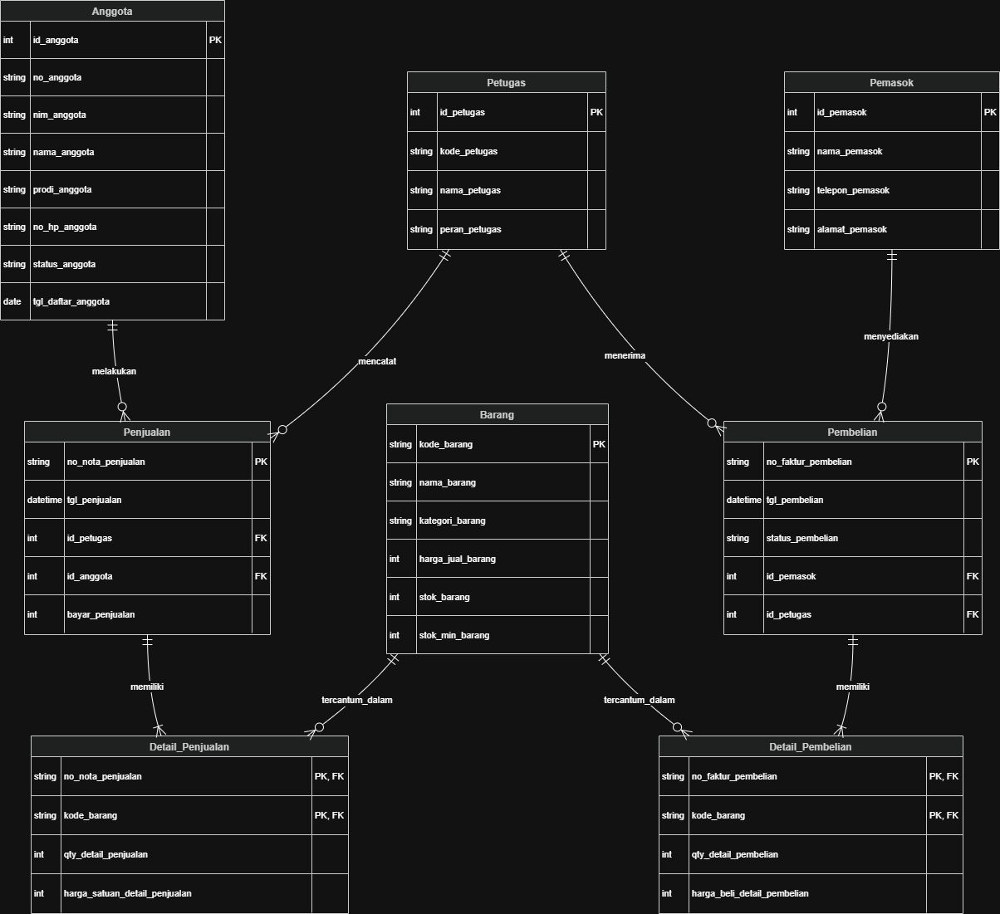
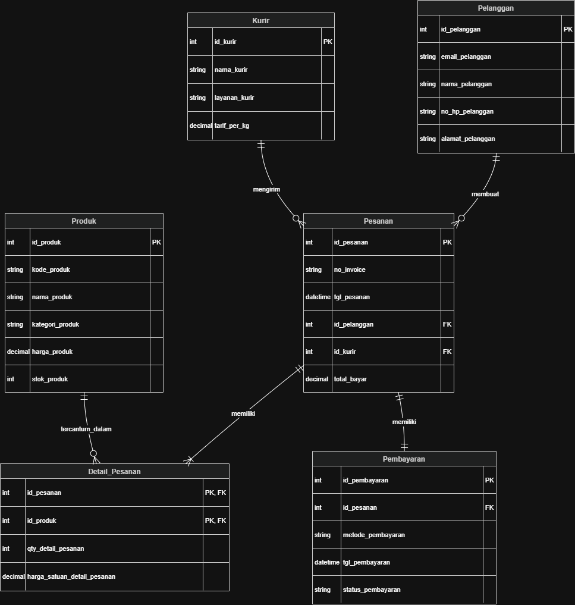

# Laporan Praktikum Basis Data - Pertemuan 3

**Nama:** Arman Ardinansyah  
**NPM:** 25430071  
**Kelas:** C  
**Tanggal:** 7 Oktober 2026  
**Dosen Pengampu:** Dedi Irawan, S.Kom., M.T.I.

---

## 1. Tujuan Praktikum
1. Mengidentifikasi entitas, atribut, dan kunci (PK/FK) dari dokumen kebutuhan data.
2. Menentukan relasi, kardinalitas, dan partisipasi antarentitas berdasarkan aturan bisnis.
3. Memecah relasi banyak-ke-banyak menjadi entitas asosiatif.
4. Menggambar ERD notasi Crow's Foot dan memvalidasinya terhadap kebutuhan informasi (KI).

---

## 2. Ringkasan Dasar Teori
Entity-Relationship Diagram (ERD) adalah pemodelan data konseptual yang menggambarkan entitas, atribut, dan relasi antarentitas. Pada notasi Crow's Foot, kardinalitas menyatakan jumlah maksimum dan partisipasi menyatakan jumlah minimum pasangan dalam relasi. Relasi banyak-ke-banyak tidak bisa disimpan langsung pada tabel relasional sehingga harus dipecah menggunakan entitas asosiatif.

---

## 3. Hasil Langkah Percobaan
Berikut adalah hasil pembuatan ERD untuk studi kasus Kopma:

---

## 4. Jawaban Titik Analisis
* **Titik Analisis 1**: `id_anggota` dipakai sebagai kunci primer (surrogate key) berjenis integer agar proses perindeksan dan pencarian data berjalan lebih cepat dibanding string. Risiko jika NIM dijadikan kunci primer adalah jika ada kesalahan input NIM di awal, pembaruan data harus dilakukan secara berantai ke seluruh tabel relasi.
* **Titik Analisis 2**: Sisi penjualan terhadap detail_penjualan bernilai 1..N (satu atau banyak) karena aturan bisnis AB-01 mewajibkan setiap nota memuat minimal satu jenis barang. Aturan ini tidak dapat dijaga oleh DDL tabel saja, melainkan harus ditangani lewat transaksi bisnis (Modul 14).
* **Titik Analisis 3**: Agar sistem mencatat petugas gudang yang menerima barang, relasi ditambahkan antara entitas Petugas dan Pembelian dengan menyimpan `id_petugas` sebagai kunci tamu di tabel Pembelian.

---

## 5. Hasil Latihan dan Modifikasi
Hasil modifikasi ERD untuk mencatat petugas penerima barang pada transaksi pembelian telah dimasukkan ke dalam diagram Kopma.

---

## 6. Tugas Mandiri: Milestone Proyek 3 (Toko Daring)

### Gambar ERD Proyek Toko Daring

### Pemetaan Entitas ke Proses Bisnis (PB) dan Kebutuhan Informasi (KI)

| Entitas | Pemetaan PB / KI | Keterangan |
|---|---|---|
| **Pelanggan** | PB-01, KI-04 | Menyimpan data pembeli dan mendukung analisis pelanggan teraktif |
| **Produk** | PB-02, PB-03, KI-02, KI-03 | Katalog produk, stok minimum, dan laporan produk terlaris |
| **Pesanan** | PB-02, KI-01, KI-04 | Kepala transaksi penjualan toko daring |
| **Detail_Pesanan** | PB-02, KI-01, KI-02, KI-04 | Entitas asosiatif pemecah relasi banyak-ke-banyak |
| **Kurir** | PB-04 | Mengelola ekspedisi dan tarif pengiriman pesanan |
| **Pembayaran** | PB-02, KI-01 | Mencatat transaksi pembayaran digital |

### Tabel Kardinalitas dan Aturan Bisnis (AB)

| Relasi | Sisi Kiri | Sisi Kanan | Dasar Aturan Bisnis |
|---|---|---|---|
| Pelanggan membuat Pesanan | 1 (Tepat Satu) | 0..N (Nol atau Banyak) | AB-02 (Pelanggan baru belum tentu punya pesanan) |
| Kurir mengirim Pesanan | 1 (Tepat Satu) | 0..N (Nol atau Banyak) | AB-06 (Satu kurir bisa menangani banyak pesanan) |
| Pesanan memiliki Detail_Pesanan | 1 (Tepat Satu) | 1..N (Satu atau Banyak) | AB-01 (Pesanan wajib memuat minimal 1 item) |
| Produk tercantum di Detail_Pesanan | 1 (Tepat Satu) | 0..N (Nol atau Banyak) | AB-04 (Harga dicatat saat transaksi) |
| Pesanan memiliki Pembayaran | 1 (Tepat Satu) | 1..1 (Tepat Satu) | AB-02 (Setiap pesanan memiliki satu pembayaran) |

### Penelusuran KI ke Jalur ERD

| Kode KI | Kebutuhan Informasi | Jalur Penelusuran ERD |
|---|---|---|
| **KI-01** | Laporan omzet harian & bulanan | `Pesanan` -> `Detail_Pesanan` |
| **KI-02** | 5 Produk terlaris per bulan | `Detail_Pesanan` -> `Produk` |
| **KI-03** | Daftar produk stok menipis | `Produk` |
| **KI-04** | 10 Pelanggan belanja terbesar | `Pelanggan` -> `Pesanan` -> `Detail_Pesanan` |

### Catatan Tinjauan Klien

| No | Umpan Balik Klien (Rekan Sekelas) | Status Keputusan | Alasan Keputusan |
|---|---|---|---|
| 1 | Tambahkan entitas `Kurir` agar tarif pengiriman terpisah dari pesanan. | Diterima | Memudahkan pengelolaan daftar ekspedisi dan perhitungan ongkir. |
| 2 | Pisahkan entitas `Pembayaran` dari entitas `Pesanan`. | Diterima | Memungkinkan pencatatan metode dan verifikasi pembayaran secara eksplisit. |

---

## 7. Pembahasan dan Kendala
* **Kendala**: Menentukan kardinalitas relasi antara Pelanggan dan Pesanan serta memastikan seluruh transaksi menyimpan snapshot harga saat transaksi terjadi.
* **Solusi**: Menyimpan `harga_satuan_detail_pesanan` pada entitas `Detail_Pesanan` agar perubahan harga produk master tidak merubah riwayat harga transaksi lama.

---

## 8. Kesimpulan
Pemodelan ERD berhasil mentransformasikan dokumen kebutuhan data menjadi rancangan visual konseptual. Pemecahan relasi banyak-ke-banyak menjadi entitas asosiatif `Detail_Pesanan` menjamin integritas data transaksi dan memudahkan penyusunan kueri untuk menjawab seluruh Kebutuhan Informasi (KI).

---

## 9. Pernyataan Penggunaan AI
Penggunaan AI (Gemini) dibatasi hanya sebagai media diskusi untuk mengecek kerapian format Markdown dan memverifikasi keterbacaan struktur diagram. Seluruh penyusunan proses bisnis, penentuan entitas, aturan bisnis, serta analisis kebutuhan data dikerjakan dan divalidasi secara mandiri sesuai dengan ketentuan modul praktikum.

---

## 10. Bukti Git
* **Tautan Repositori**: `https://github.com/armanardinansyah05-lab/basisdata_25430071`
* **Hash Commit**: `afca8d2` (Pesan: `p03: erd kopma`)

---

## Checklist Laporan Pertemuan 3

### Checklist Umum
- [x] Identitas lengkap (Nama, NPM, Kelas, Tanggal)
- [x] Tujuan praktikum ditulis ulang
- [x] Ringkasan dasar teori
- [x] Hasil langkah percobaan
- [x] Jawaban titik analisis (1-3)
- [x] Hasil latihan dan modifikasi
- [x] Tugas mandiri (Milestone Proyek 3)
- [x] Pembahasan dan kendala
- [x] Kesimpulan
- [x] Pernyataan penggunaan AI
- [x] Bukti Git (tautan repositori & hash commit)

### Checklist Khusus Pertemuan 3
- [x] **Berkas Wajib**: Berkas sumber diagram (`p03_erd_kopma_25430071.drawio` & `p03_erd_25430071.drawio`).
- [x] **Bukti Tangkapan Layar**: ERD di draw.io dengan kardinalitas terbaca jelas serta catatan tinjauan klien.
- [x] **Analisis Wajib**: Pemetaan setiap entitas ke Proses Bisnis (PB) dan Kebutuhan Informasi (KI) dari Pertemuan 2, serta penjelasan alasan kardinalitas relasi utama.