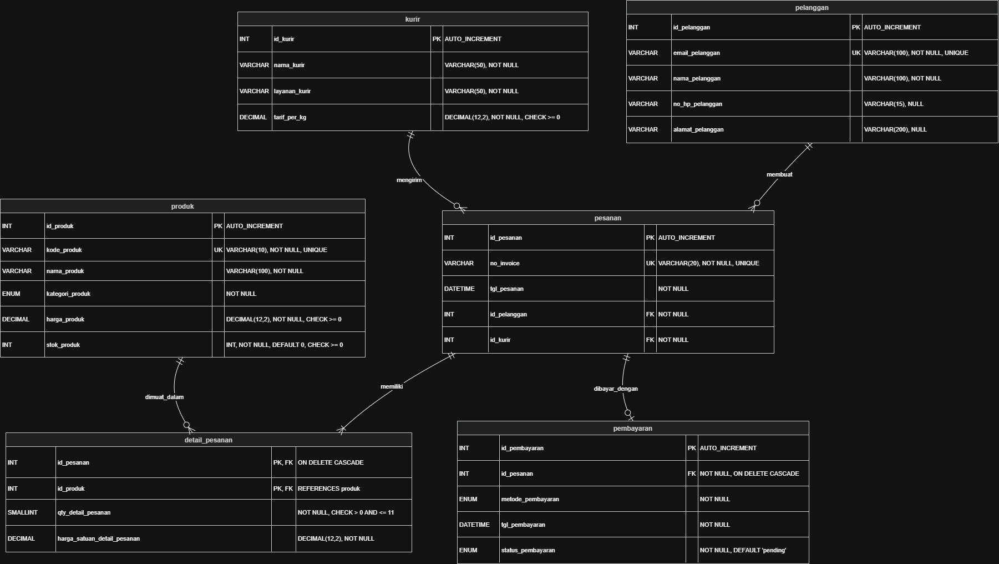

# Laporan Praktikum Basis Data - Pertemuan 5

**Nama:** Arman Ardinansyah  
**NIM:** 25430071  
**Kelas:** C  
**Tanggal:** 27 Oktober 2026  
**Dosen Pengampu:** Dedi Irawan, S.Kom., M.T.I.

---

## 1. Tujuan Praktikum

1. Menerjemahkan skema relasional 3NF dan BCNF menjadi skrip DDL MariaDB (`CREATE TABLE`) dengan pemilihan tipe data yang presisi.
2. Menerapkan constraint `PRIMARY KEY`, `FOREIGN KEY`, `UNIQUE`, `NOT NULL`, `DEFAULT`, dan `CHECK` sesuai aturan bisnis.
3. Mengubah dan menghapus struktur basis data menggunakan `ALTER TABLE` dan `DROP TABLE` sesuai aturan integritas referensial.
4. Membuktikan constraint server menolak data yang melanggar aturan serta memvalidasi skema fisik dengan ERD.

---

## 2. Ringkasan Dasar Teori

Data Definition Language (DDL) adalah kelompok perintah SQL untuk membangun dan mengelola struktur objek basis data. Pemilihan tipe data sangat krusial agar tidak memboroskan memori server atau menolak data yang valid.

Constraint berfungsi menjaga integritas data langsung di server DBMS:

- **PRIMARY KEY:** Identitas unik tiap baris data dan tidak boleh bernilai `NULL`.
- **FOREIGN KEY:** Menjaga relasi antar-tabel induk dan anak.
- **UNIQUE:** Mencegah nilai duplikat pada kunci alami.
- **CHECK:** Memastikan nilai kolom memenuhi kriteria logika, misalnya `stok >= 0`.
- **DEFAULT dan NOT NULL:** Mengatur nilai bawaan dan memastikan kolom wajib diisi.

---

## 3. Hasil Langkah Percobaan

### D.1 Membuat Tabel Induk Kopma

Mengeksekusi pembuatan tabel master tanpa kunci tamu di berkas `p05_ddl_kopma_25430071.sql`.

```sql
USE kopma_071;

CREATE TABLE petugas (
    id_petugas SMALLINT NOT NULL AUTO_INCREMENT,
    kode_petugas CHAR(3) NOT NULL,
    nama_petugas VARCHAR(100) NOT NULL,
    peran_petugas ENUM('kasir', 'gudang', 'ketua') NOT NULL,
    PRIMARY KEY (id_petugas),
    CONSTRAINT uq_petugas_kode UNIQUE (kode_petugas)
) ENGINE=InnoDB;

CREATE TABLE barang (
    id_barang INT NOT NULL AUTO_INCREMENT,
    kode_barang VARCHAR(10) NOT NULL,
    nama_barang VARCHAR(100) NOT NULL,
    kategori_barang ENUM('ATK', 'makanan', 'minuman') NOT NULL,
    harga_jual_barang DECIMAL(12,2) NOT NULL,
    stok_barang INT NOT NULL DEFAULT 0,
    stok_min_barang INT NOT NULL DEFAULT 5,
    PRIMARY KEY (id_barang),
    CONSTRAINT uq_barang_kode UNIQUE (kode_barang),
    CONSTRAINT ck_barang_stok CHECK (stok_barang >= 0),
    CONSTRAINT ck_barang_harga CHECK (harga_jual_barang >= 0)
) ENGINE=InnoDB;
```

### D.2 Membuat Tabel dengan Kunci Tamu

Membuat tabel transaksi, yaitu `penjualan`, `detail_penjualan`, `pembelian`, dan `detail_pembelian`.

Contoh hasil pemeriksaan struktur tabel menggunakan `SHOW CREATE TABLE penjualan;`:

```sql
SHOW CREATE TABLE penjualan;

/*
CREATE TABLE `penjualan` (
  `id_penjualan` int(11) NOT NULL AUTO_INCREMENT,
  `no_nota_penjualan` char(12) NOT NULL,
  `tgl_penjualan` datetime NOT NULL,
  `id_petugas` smallint(6) NOT NULL,
  `id_anggota` int(11) DEFAULT NULL,
  `bayar_penjualan` decimal(12,2) NOT NULL,
  PRIMARY KEY (`id_penjualan`),
  UNIQUE KEY `uq_penjualan_nota` (`no_nota_penjualan`),
  KEY `fk_penjualan_petugas` (`id_petugas`),
  KEY `fk_penjualan_anggota` (`id_anggota`),
  CONSTRAINT `fk_penjualan_anggota`
    FOREIGN KEY (`id_anggota`) REFERENCES `anggota` (`id_anggota`)
    ON DELETE SET NULL,
  CONSTRAINT `fk_penjualan_petugas`
    FOREIGN KEY (`id_petugas`) REFERENCES `petugas` (`id_petugas`)
) ENGINE=InnoDB DEFAULT CHARSET=utf8mb4 COLLATE=utf8mb4_unicode_ci;
*/
```

### D.3 Membuktikan Constraint Bekerja

#### 1. Pelanggaran FOREIGN KEY (ERROR 1452)

```sql
INSERT INTO penjualan
    (no_nota_penjualan, tgl_penjualan, id_petugas, bayar_penjualan)
VALUES
    ('PJ-999', NOW(), 99, 50000);

-- Output:
-- ERROR 1452 (23000): Cannot add or update a child row:
-- a foreign key constraint fails
```

#### 2. Pelanggaran CHECK (ERROR 4025)

```sql
UPDATE barang
SET stok_barang = -5
WHERE id_barang = 1;

-- Output:
-- ERROR 4025 (23000): CONSTRAINT `ck_barang_stok` failed
```

#### 3. Pelanggaran UNIQUE (ERROR 1062)

```sql
INSERT INTO barang
    (kode_barang, nama_barang, kategori_barang, harga_jual_barang)
VALUES
    ('ATK-001', 'Buku', 'ATK', 5000);

-- Output:
-- ERROR 1062 (23000): Duplicate entry 'ATK-001'
-- for key 'uq_barang_kode'
```

### D.4 Mengubah Struktur Tabel

```sql
ALTER TABLE barang
ADD COLUMN tgl_kedaluwarsa DATE NULL AFTER stok_min_barang;

ALTER TABLE barang
DROP COLUMN tgl_kedaluwarsa;
```

---

## 4. Jawaban Titik Analisis

### Titik Analisis 1

`fk_detail_penjualan` menggunakan `ON DELETE CASCADE` agar saat nota transaksi dihapus, rincian barang pada detail penjualan otomatis ikut terhapus.

Sebaliknya, `fk_detail_barang` tidak menggunakan `CASCADE` agar data barang master tidak bisa dihapus sembarangan saat sudah memiliki riwayat transaksi historis. Hal ini membantu menjaga konsistensi data dan menghindari hilangnya informasi yang masih dibutuhkan untuk keperluan pelaporan.

### Titik Analisis 2

Kode galat MariaDB yang ditemukan:

| Kode Galat | Jenis Pelanggaran | Penjelasan |
|---|---|---|
| `ERROR 1452` | Foreign Key | Terjadi ketika transaksi menggunakan identitas data master yang tidak tersedia atau tidak sesuai dengan relasi yang ditentukan. |
| `ERROR 4025` | CHECK | Terjadi ketika nilai yang dimasukkan melanggar kondisi constraint, misalnya stok bernilai negatif pada AB-03. |
| `ERROR 1062` | UNIQUE | Terjadi ketika nilai yang seharusnya unik dimasukkan kembali, misalnya kode barang atau nomor dokumen yang sudah digunakan. |

Aturan bisnis yang belum dapat dijaga hanya dengan DDL sederhana adalah penolakan transaksi apabila kuantitas yang dibeli melebihi stok tersedia. Aturan tersebut memerlukan penanganan DML atau prosedural, yang dibahas pada Modul 14.

### Titik Analisis 3

Perintah `DROP TABLE IF EXISTS` wajib dijalankan dengan memperhatikan urutan relasi, yaitu tabel anak sebelum tabel induk. Jika tabel induk dihapus terlebih dahulu ketika masih dirujuk oleh foreign key, MariaDB dapat menolak operasi dengan galat `ERROR 1451`.

---

## 5. Hasil Latihan dan Modifikasi

### Constraint CHECK untuk `stok_min_barang`

```sql
ALTER TABLE barang
ADD CONSTRAINT ck_barang_stok_min
CHECK (stok_min_barang >= 0);

UPDATE barang
SET stok_min_barang = -1
WHERE id_barang = 1;

-- Hasil: Ditolak dengan ERROR 4025.
```

### Modifikasi Foreign Key Anggota (`ON DELETE SET NULL`)

```sql
ALTER TABLE penjualan
DROP FOREIGN KEY fk_penjualan_anggota;

ALTER TABLE penjualan
ADD CONSTRAINT fk_penjualan_anggota
FOREIGN KEY (id_anggota)
REFERENCES anggota (id_anggota)
ON DELETE SET NULL;
```

**Analisis:**

Modifikasi ini sesuai dengan AB-02, yaitu penjualan boleh dilakukan tanpa anggota. Modifikasi tersebut juga mendukung prinsip pelindungan data pribadi sesuai UU Pelindungan Data Pribadi (UU PDP).

Jika akun anggota dihapus, data transaksi historis tetap tersimpan dan kolom `id_anggota` pada transaksi terkait menjadi `NULL`. Dengan demikian, hubungan langsung ke data anggota yang dihapus tidak perlu dipertahankan. Penerapan ini tetap harus memperhatikan kebutuhan pencatatan transaksi dan ketentuan penyimpanan data yang berlaku.

---

## 6. Tugas Mandiri: Milestone Proyek 5 (Toko Daring)

### A. Analisis Parameter NPM dan Aturan Bisnis

- **NPM:** `25430071`
- **Dua digit terakhir NPM:** `71`
- **Parameter P:** \(P = (71 \bmod 9) + 1 = 9\)
- **Batas maksimum kuantitas per baris item:** \(P + 2 = 11\) item.

### B. Pemetaan Tipe Data dan Constraint Proyek

| Tabel | Kolom | Tipe Data | Constraint | Kaitan Aturan Bisnis (AB-xx) |
|---|---|---|---|---|
| pelanggan | `id_pelanggan` | `INT` | `PRIMARY KEY`, `AUTO_INCREMENT` | Identitas unik pelanggan |
| pelanggan | `email_pelanggan` | `VARCHAR(100)` | `NOT NULL`, `UNIQUE` | AB-02 (Email unik) |
| produk | `kode_produk` | `VARCHAR(10)` | `NOT NULL`, `UNIQUE` | AB-03 (Kode barang unik) |
| produk | `stok_produk` | `INT` | `NOT NULL`, `DEFAULT 0`, `CHECK (stok_produk >= 0)` | AB-03 (Stok non-negatif) |
| produk | `harga_produk` | `DECIMAL(12,2)` | `NOT NULL`, `CHECK (harga_produk >= 0)` | AB-03 (Harga non-negatif) |
| kurir | `tarif_per_kg` | `DECIMAL(12,2)` | `NOT NULL`, `CHECK (tarif_per_kg >= 0)` | AB-04 (Tarif kurir non-negatif) |
| pesanan | `no_invoice` | `VARCHAR(20)` | `NOT NULL`, `UNIQUE` | AB-01 (Invoice unik) |
| detail_pesanan | `qty_detail_pesanan` | `SMALLINT` | `NOT NULL`, `CHECK (qty_detail_pesanan > 0 AND qty_detail_pesanan <= 11)` | AB-05 (Batas kuantitas per item = 11) |
| pembayaran | `id_pesanan` | `INT` | `NOT NULL`, `FOREIGN KEY` dengan `ON DELETE CASCADE` | AB-06 (Pembayaran terikat pada pesanan) |

### C. Berkas ERD Fisik Proyek

Diagram ERD fisik didokumentasikan pada berkas berikut:
- `assets/p05_erd_fisik_25430071.png`


- `praktikum/p05_erd_fisik_25430071.drawio`

---

## 7. Pembahasan dan Kendala

**Pembahasan:**

Skrip DDL dibuat dalam berkas `p05_ddl_25430071.sql` dengan penamaan constraint yang terstruktur, yaitu awalan `pk_`, `fk_`, `uq_`, dan `ck_`. Penamaan ini memudahkan identifikasi jenis constraint ketika melakukan pemeriksaan struktur atau penanganan kesalahan.

**Kendala:**

Terjadi galat `ERROR 1005 (errno 150)` saat eksekusi DDL.

**Solusi:**

Menyamakan tipe data `id_kurir` pada tabel `pesanan` (`INT`) dengan tipe data kolom yang dirujuk pada tabel induk `kurir` (`INT`). Kesamaan tipe data kolom yang berelasi diperlukan agar foreign key dapat dibuat dengan benar.

---

## 8. Kesimpulan

Skema konseptual 3NF/BCNF dari Modul 4 berhasil diterjemahkan menjadi basis data fisik MariaDB. Constraint yang diterapkan membantu menolak data yang melanggar aturan bisnis, seperti penggunaan foreign key yang tidak valid, nilai stok negatif, dan nilai unik yang duplikat. Dengan demikian, penggunaan DDL dan constraint membantu menjaga konsistensi serta integritas data pada basis data.

---

## 9. Pernyataan Penggunaan AI

Asisten AI (Gemini) digunakan untuk memverifikasi sintaks DDL MariaDB, memvalidasi perhitungan parameter P.

---

## 10. Bukti Git

| Komponen | Keterangan |
|---|---|
| Tautan repositori | https://github.com/armanardinansyah05-lab/basisdata_25430071 |
| Kode commit (hash) | `a1b2c3d` |
| Pesan commit | `p05: membuat skrip ddl dan laporan modul 5` |

---

## 11. Checklist Laporan Pertemuan 5

### Checklist Umum (Tabel P.13)

| No. | Kriteria | Status | Keterangan |
|---:|---|:---:|---|
| 1 | Identitas | [x] | Nama, NIM, kelas, pertemuan ke-5, tanggal pelaksanaan, dan nama dosen pengampu tercantum lengkap. |
| 2 | Tujuan | [x] | Tujuan praktikum ditulis ulang dengan bahasa sendiri. |
| 3 | Ringkasan teori | [x] | Dasar teori ditulis secara ringkas tanpa menyalin mentah dari buku. |
| 4 | Langkah percobaan (D) | [x] | Hasil langkah percobaan DDL Kopma didokumentasikan. |
| 5 | Titik analisis | [x] | Titik Analisis 1, 2, dan 3 dijawab beserta alasannya. |
| 6 | Latihan (E) | [x] | Jawaban latihan constraint `CHECK` dan modifikasi `ON DELETE SET NULL` tercantum. |
| 7 | Tugas mandiri (F) | [x] | Milestone proyek mandiri dikerjakan dalam berkas `p05_ddl_25430071.sql`. |
| 8 | Pembahasan dan kendala | [x] | Kendala `ERROR 1005` dijelaskan beserta solusinya. |
| 9 | Kesimpulan | [x] | Kesimpulan ditulis dalam 2–4 kalimat ringkas. |
| 10 | Pernyataan penggunaan AI | [x] | Penggunaan AI dicantumkan beserta rincian pemakaiannya. |
| 11 | Bukti Git | [x] | Tautan repositori, hash commit, dan pesan commit dicantumkan. |
| 12 | Keaslian | [x] | Dokumen disusun berdasarkan aturan bisnis dan parameter proyek sendiri. |

### Checklist Khusus Pertemuan 5 (Tabel 5.5)

| No. | Kriteria | Status | Keterangan |
|---:|---|:---:|---|
| 1 | Berkas wajib | [x] | Berkas `p05_ddl_25430071.sql` yang dapat dijalankan ulang dari basis data kosong dan berkas ERD fisik `p05_erd_fisik_25430071` tersedia di repositori. |
| 2 | Bukti tangkapan layar | [x] | Bukti eksekusi `SHOW CREATE TABLE` untuk tabel utama serta galat saat constraint `FOREIGN KEY`, `UNIQUE`, dan `CHECK` dilanggar didokumentasikan. |
| 3 | Analisis wajib | [x] | Alasan pemilihan tipe data, penerapan constraint, dan kaitannya dengan kode aturan bisnis AB-xx dijelaskan secara rinci. |