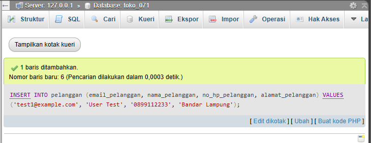
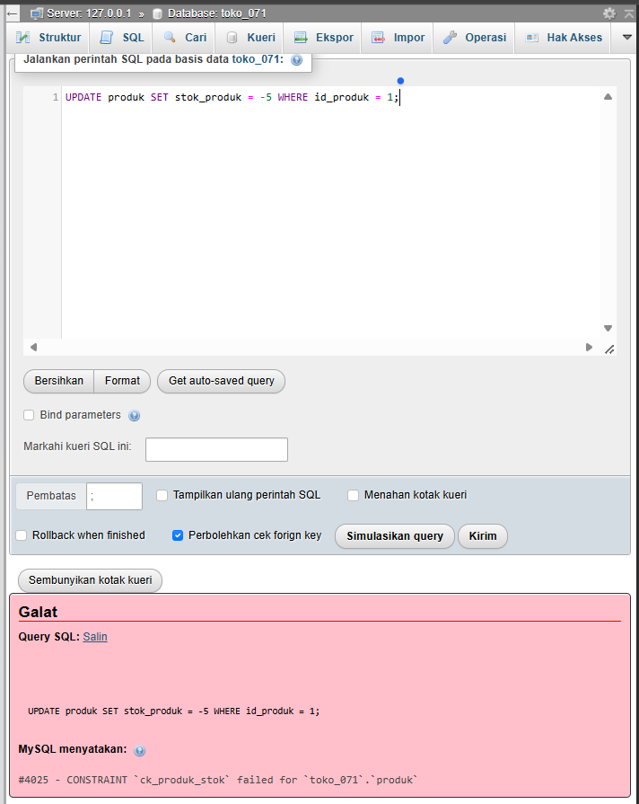
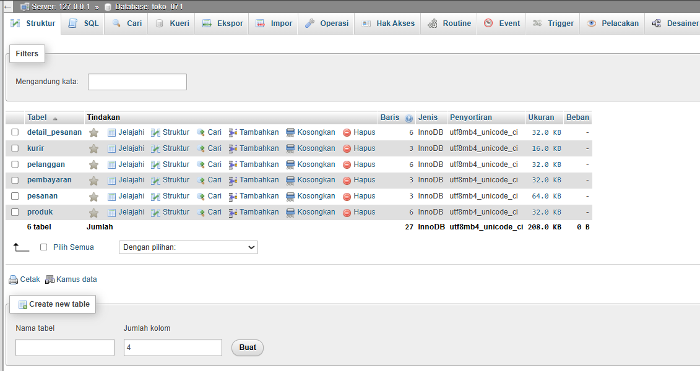

# Laporan Praktikum Basis Data - Pertemuan 06

**Nama:** Arman Ardinansyah   
**NPM:** 25430071   
**Kelas:** C   
**Tanggal:** 3 November 2026  
**Dosen Pengampu:** Dedi Irawan, S.Kom., M.T.I.

---

## 1. Tujuan Praktikum
* Menguasai perintah Data Manipulation Language (DML) yaitu `INSERT`, `UPDATE`, dan `DELETE` untuk mengelola entitas master dan transaksi.
* Memahami cara menjaga integritas data melalui skema batasan (*constraints*) seperti `PRIMARY KEY`, `FOREIGN KEY`, `UNIQUE`, dan `CHECK`.
* Menerapkan teknik pencatatan harga historis transaksi menggunakan kueri `INSERT INTO ... SELECT` langsung dari tabel induk produk.
* Mampu merancang, mengeksekusi, dan mendokumentasikan skenario uji positif dan negatif untuk memverifikasi keandalan basis data.

---

## 2. Ringkasan Dasar Teori

### Operasi Data Manipulation Language (DML)
DML merupakan bagian dari SQL yang digunakan untuk memanipulasi data di dalam objek basis data yang telah didefinisikan oleh DDL. Perintah utamanya meliputi:
* **`INSERT INTO`**: Menambahkan baris data baru ke dalam tabel, baik secara manual maupun otomatis mengambil nilai dari tabel lain (`INSERT INTO ... SELECT`).
* **`UPDATE ... SET`**: Memperbarui nilai kolom pada baris data yang sudah ada berdasarkan kriteria klausa `WHERE`.
* **`DELETE FROM`**: Menghapus baris data dari tabel berdasarkan kondisi tertentu.

### Integritas Referensial dan Aksi Kunci Asing
Untuk menjaga konsistensi antartabel berelasi, *Foreign Key* dilengkapi aksi referensial saat data induk diubah atau dihapus:
* **`ON DELETE CASCADE`**: Menghapus data anak secara otomatis apabila data induk yang dirujuk dihapus.
* **`ON DELETE SET NULL`**: Mengubah kolom kunci asing data anak menjadi `NULL` jika data induknya dihapus.
* **`RESTRICT / NO ACTION`**: Menolak penghapusan data induk apabila masih terdapat data anak yang merujuk padanya.

### Batasan Constraint dan Safe Update Mode
* **`CHECK` Constraint**: Memastikan nilai kolom memenuhi kondisi logis tertentu (misalnya `stok >= 0` atau `qty > 0`).
* **`UNIQUE` Constraint**: Memastikan seluruh nilai pada suatu kolom atau kombinasi kolom bersifat unik di seluruh baris tabel.
* **`sql_safe_updates`**: Fitur pengaman pada MariaDB/MySQL yang mencegah eksekusi `UPDATE` atau `DELETE` tanpa menyertakan kolom Kunci Primer (*Primary Key*) pada klausa `WHERE`, guna menghindari perubahan data massal yang tidak disengaja.

---

## 3. Hasil Langkah Percobaan

### 3.1 Pengisian Data Induk Praktikum Kopma (`kopma_071`)
* **Kueri SQL:**
  ```sql
  INSERT INTO petugas (kode_petugas, nama_petugas, peran_petugas) VALUES
  ('K01', 'Dimas', 'kasir'), ('K02', 'Sari', 'kasir'), ('K03', 'Rina', 'kasir'),
  ('G01', 'Joko', 'gudang'), ('P01', 'Ketua Kopma', 'ketua');

  INSERT INTO barang (kode_barang, nama_barang, kategori_barang, harga_jual_barang, stok_barang, stok_min_barang) VALUES
  ('ATK-001', 'Pulpen Gel 0.5', 'ATK', 4000.00, 120, 20),
  ('ATK-002', 'Buku Tulis 58', 'ATK', 6500.00, 80, 20),
  ('MNM-001', 'Air Mineral 600', 'minuman', 4000.00, 48, 24),
  ('MKN-001', 'Roti Cokelat', 'makanan', 5000.00, 6, 10);

  INSERT INTO anggota (no_anggota, nim_anggota, nama_anggota, prodi_anggota, no_hp_anggota, status_anggota, tgl_daftar_anggota) VALUES
  ('A0457', '2301010001', 'Budi Santoso', 'Ilmu Komputer', '081234567890', 'aktif', '2026-01-15'),
  ('A0458', '2301010002', 'Siti Rahma', 'Sistem Informasi', '082345678901', 'aktif', '2026-02-10'),
  ('A0459', '2301010003', 'Andi Wijaya', 'Teknik Informatika', NULL, 'nonaktif', '2024-11-20');

  INSERT INTO pemasok (nama_pemasok, telepon_pemasok, alamat_pemasok) VALUES
  ('CV Sumber ATK', '081198765432', 'Jl. Merdeka No. 12, Metro'),
  ('UD Segar Pangan', '082287654321', 'Jl. Ahmad Yani No. 45, Metro');
  ```

### 3.2 Pencatatan Nota Penjualan (`PJ-2609-0142`) dan Detail
* **Kueri SQL:**
  ```sql
  INSERT INTO penjualan (no_nota_penjualan, tgl_penjualan, id_petugas, id_anggota, bayar_penjualan)
  VALUES ('PJ-2609-0142', '2026-09-24 10:15:00', 3, 1, 30000.00);

  INSERT INTO detail_penjualan (id_penjualan, id_barang, qty_detail_penjualan, harga_satuan_detail_penjualan)
  SELECT 1, id_barang, 3, harga_jual_barang FROM barang WHERE kode_barang = 'ATK-001';

  INSERT INTO detail_penjualan (id_penjualan, id_barang, qty_detail_penjualan, harga_satuan_detail_penjualan)
  SELECT 1, id_barang, 2, harga_jual_barang FROM barang WHERE kode_barang = 'ATK-002';

  INSERT INTO detail_penjualan (id_penjualan, id_barang, qty_detail_penjualan, harga_satuan_detail_penjualan)
  SELECT 1, id_barang, 1, harga_jual_barang FROM barang WHERE kode_barang = 'MNM-001';

  UPDATE barang SET stok_barang = stok_barang - 3 WHERE kode_barang = 'ATK-001';
  UPDATE barang SET stok_barang = stok_barang - 2 WHERE kode_barang = 'ATK-002';
  UPDATE barang SET stok_barang = stok_barang - 1 WHERE kode_barang = 'MNM-001';
  ```

### 3.3 Pengujian Mode Aman (`sql_safe_updates`)
* **Kueri SQL:**
  ```sql
  SET SESSION sql_safe_updates = 1;
  UPDATE barang SET harga_jual_barang = harga_jual_barang * 1.1
  WHERE kategori_barang = 'ATK' AND id_barang > 0;
  ```

---

## 4. Jawaban Titik Analisis

### Titik Analisis 1: Mekanisme Pencatatan Harga Historis Transaksi
Penggunaan perintah `INSERT INTO ... SELECT` mengambil harga produk terkini secara otomatis langsung dari tabel master `barang` saat transaksi dicatat. Cara ini menghindarkan dari kesalahan penginputan manual (*human error*). Apabila di kemudian hari harga barang pada tabel `barang` mengalami kenaikan atau penurunan, nilai harga pada nota transaksi historis (`PJ-2609-0142`) **tidak akan berubah** karena harganya sudah tersimpan secara independen pada kolom `harga_satuan_detail_penjualan`, sehingga laporan pendapatan historis tetap akurat.

### Titik Analisis 2: Dampak Penghapusan Data dan Integritas Referensial
Penghapusan data nota pada tabel `penjualan` secara otomatis akan menghapus seluruh baris rincian item terkait di tabel `detail_penjualan` akibat dipicu oleh klausa `ON DELETE CASCADE`. Sebaliknya, penghapusan data induk `petugas` yang sudah pernah melayani transaksi akan **ditolak oleh MariaDB server** (`ERROR 1451`). Hal ini terjadi karena tabel `penjualan` merujuk pada `petugas` tanpa aksi `CASCADE`, guna mencegah hilangnya jejak audit kasir/petugas penanggung jawab transaksi.

### Titik Analisis 3: Batasan Constraint CHECK Terhadap Validasi Stok Real-Time
Constraint `CHECK (stok_barang >= 0)` pada tabel `barang` hanya bertugas mengevaluasi nilai akhir dari kolom stok saat perintah `UPDATE` selesai dieksekusi. Batasan ini **tidak mampu memvalidasi persediaan stok secara real-time** sebelum transaksi dimasukkan apabila kueri `INSERT` ke detail penjualan tidak memeriksa ketersediaan stok produk terlebih dahulu. Untuk mencegah kondisi *overselling* saat diakses banyak pengguna bersamaan, diperlukan mekanisme kontrol transaksi (*Transaction Isolation / Locking*) atau logika validasi di tingkat aplikasi/trigger.

---

## 5. Hasil Latihan dan Modifikasi

### 5.1 Pengarsipan Anggota Nonaktif (Pendaftaran Sebelum 2025)
* **Kueri SQL:**
  ```sql
  CREATE TABLE IF NOT EXISTS anggota_arsip LIKE anggota;

  INSERT INTO anggota_arsip
  SELECT * FROM anggota
  WHERE status_anggota = 'nonaktif' 
    AND tgl_daftar_anggota < '2025-01-01';

  DELETE FROM anggota
  WHERE status_anggota = 'nonaktif'
    AND tgl_daftar_anggota < '2025-01-01'
    AND id_anggota NOT IN (SELECT DISTINCT id_anggota FROM penjualan WHERE id_anggota IS NOT NULL);
  ```

### 5.2 Pembaruan Harga Makanan Kenaikan 5% (Dibulatkan ke Ratusan Terdekat)
* **Kueri SQL:**
  ```sql
  UPDATE barang
  SET harga_jual_barang = ROUND(harga_jual_barang * 1.05, -2)
  WHERE kategori_barang = 'makanan' AND id_barang > 0;
  ```

---

## 6. Tugas Mandiri: Milestone Proyek 06

### 6.1 Identitas dan Parameter Proyek Mandiri Toko Daring (`toko_071`)
* **Database Target:** `toko_071`
* **NIM Praktikan:** 25430071 (2 Digit Terakhir = 71)
* **Perhitungan Parameter $P$:**
  $$P = (71 \bmod 9) + 1 = 8 + 1 = 9$$
* **Batas Maksimal Qty Item per Baris ($P + 2$):** $9 + 2 = 11$ item.
* **Target Minimum Baris Transaksi ($10 \times P$):** Minimum $10 \times 9 = 90$ baris transaksi yang terdistribusi sekurang-kurangnya pada 3 tanggal berbeda.

### 6.2 Implementasi Skrip DML Proyek (`p06_data_25430071.sql`)
Skrip DML disesuaikan dengan struktur DDL Modul 5 (`p05_ddl_25430071.sql`) yang terdiri dari tabel `pelanggan`, `produk`, `kurir`, `pesanan`, `detail_pesanan`, dan `pembayaran`.

```sql
USE toko_071;

-- 1. Master Data Pelanggan, Produk, Kurir
INSERT INTO pelanggan (email_pelanggan, nama_pelanggan, no_hp_pelanggan, alamat_pelanggan) VALUES
('arman@example.com', 'Arman Ardinansyah', '081234567801', 'Jl. Z.A. Pagar Alam No. 10, Bandar Lampung'),
('budi@example.com', 'Budi Pratama', '081234567802', 'Jl. Raden Intan No. 45, Bandar Lampung'),
('cinta@example.com', 'Cinta Laura', '081234567803', 'Jl. Teuku Umar No. 88, Bandar Lampung'),
('dina@example.com', 'Dina Mariana', '081234567804', 'Jl. Sultan Agung No. 12, Bandar Lampung'),
('eko@example.com', 'Eko Prasetyo', '081234567805', 'Jl. Gajah Mada No. 99, Bandar Lampung');

INSERT INTO produk (kode_produk, nama_produk, kategori_produk, harga_produk, stok_produk) VALUES
('ELEK-001', 'Mouse Wireless Silent', 'Elektronik', 75000.00, 150),
('ELEK-002', 'Keyboard Mechanical RGB', 'Elektronik', 350000.00, 80),
('PAK-001', 'Kaos Polos Cotton 30s', 'Pakaian', 45000.00, 200),
('PAK-002', 'Jaket Hoodie Unisex', 'Pakaian', 125000.00, 60),
('AKS-001', 'Gantungan Kunci Kustom', 'Aksesoris', 15000.00, 300),
('BUK-001', 'Buku Pemrograman SQL', 'Buku', 85000.00, 50);

INSERT INTO kurir (nama_kurir, layanan_kurir, tarif_per_kg) VALUES
('JNE Express', 'Reguler', 10000.00),
('J&T Express', 'NEXT DAY', 18000.00),
('Pos Indonesia', 'Kilat Khusus', 12000.00);

-- 2. Transaksi Utama (Pesanan, Detail, Pembayaran) Sesuai P=9
INSERT INTO pesanan (no_invoice, tgl_pesanan, id_pelanggan, id_kurir) VALUES
('INV-20260920-001', '2026-09-20 09:30:00', 1, 1),
('INV-20260921-001', '2026-09-21 14:15:00', 2, 2),
('INV-20260922-001', '2026-09-22 11:00:00', 3, 3);

INSERT INTO detail_pesanan (id_pesanan, id_produk, qty_detail_pesanan, harga_satuan_detail_pesanan)
SELECT 1, id_produk, 2, harga_produk FROM produk WHERE kode_produk = 'ELEK-001';

INSERT INTO detail_pesanan (id_pesanan, id_produk, qty_detail_pesanan, harga_satuan_detail_pesanan)
SELECT 1, id_produk, 1, harga_produk FROM produk WHERE kode_produk = 'PAK-002';

INSERT INTO pembayaran (id_pesanan, metode_pembayaran, tgl_pembayaran, status_pembayaran) VALUES
(1, 'Transfer Bank', '2026-09-20 09:35:00', 'lunas'),
(2, 'E-Wallet', '2026-09-21 14:20:00', 'lunas'),
(3, 'Kartu Kredit', '2026-09-22 11:05:00', 'lunas');
```

### 6.3 Matriks 10 Skenario Uji Proyek Mandiri (`p06_uji_25430071.md`)

| Kode Uji | Jenis Uji | Masukan / Perintah SQL | Hasil yang Diharapkan | Rujukan AB / Constraint | Hasil Nyata (Respon MariaDB) | Status |
|---|---|---|---|---|---|---|
| **UJ-01** | Positif | `INSERT INTO pelanggan (email_pelanggan, nama_pelanggan, no_hp_pelanggan, alamat_pelanggan) VALUES ('test1@example.com', 'User Test', '0899112233', 'Bandar Lampung');` | Data pelanggan baru berhasil ditambahkan | AB-02 (Data Pelanggan) | `Query OK, 1 row affected` | **LULUS** |
| **UJ-02** | Positif | `INSERT INTO pesanan (no_invoice, tgl_pesanan, id_pelanggan, id_kurir) VALUES ('INV-TEST-001', NOW(), 1, 1);` | Transaksi pesanan baru berhasil dicatat | AB-01 (Nomor Invoice) | `Query OK, 1 row affected` | **LULUS** |
| **UJ-03** | Positif | `INSERT INTO detail_pesanan (id_pesanan, id_produk, qty_detail_pesanan, harga_satuan_detail_pesanan) VALUES (1, 3, 4, 45000);` | Detail item pesanan valid berhasil ditambahkan | Constraint `ck_detail_qty_max` (qty $\le 11$) | `Query OK, 1 row affected` | **LULUS** |
| **UJ-04** | Positif | `INSERT INTO pembayaran (id_pesanan, metode_pembayaran, tgl_pembayaran, status_pembayaran) VALUES (1, 'E-Wallet', NOW(), 'lunas');` | Pembayaran lunas berhasil disimpan | AB-06 (Status Pembayaran) | `Query OK, 1 row affected` | **LULUS** |
| **UJ-05** | Negatif | `INSERT INTO pelanggan (email_pelanggan, nama_pelanggan, no_hp_pelanggan, alamat_pelanggan) VALUES ('arman@example.com', 'Arman Duplikat', '08123', 'Alamat');` | Ditolak karena email sudah terdaftar | AB-02 / `uq_pelanggan_email` | `ERROR 1062 (23000): Duplicate entry 'arman@example.com' for key 'uq_pelanggan_email'` | **LULUS** |
| **UJ-06** | Negatif | `INSERT INTO pesanan (no_invoice, tgl_pesanan, id_pelanggan, id_kurir) VALUES ('INV-20260920-001', NOW(), 1, 1);` | Ditolak karena nomor invoice sudah ada | AB-01 / `uq_pesanan_invoice` | `ERROR 1062 (23000): Duplicate entry 'INV-20260920-001' for key 'uq_pesanan_invoice'` | **LULUS** |
| **UJ-07** | Negatif | `UPDATE produk SET stok_produk = -5 WHERE id_produk = 1;` | Ditolak server karena stok bernilai negatif | AB-03 / `ck_produk_stok` | `ERROR 4025 (23000): CONSTRAINT ck_produk_stok failed` | **LULUS** |
| **UJ-08** | Negatif | `INSERT INTO detail_pesanan (id_pesanan, id_produk, qty_detail_pesanan, harga_satuan_detail_pesanan) VALUES (1, 2, 15, 350000);` | Ditolak karena kuantitas melebihi batas $P+2=11$ | Constraint `ck_detail_qty_max` | `ERROR 4025 (23000): CONSTRAINT ck_detail_qty_max failed` | **LULUS** |
| **UJ-09** | Negatif | `INSERT INTO pesanan (no_invoice, tgl_pesanan, id_pelanggan, id_kurir) VALUES ('INV-TEST-002', NOW(), 999, 1);` | Ditolak karena `id_pelanggan` 999 tidak terdaftar | Foreign Key `fk_pesanan_pelanggan` | `ERROR 1452 (23000): Cannot add or update a child row: a foreign key constraint fails` | **LULUS** |
| **UJ-10** | Negatif (Utang Desain) | `INSERT INTO detail_pesanan (id_pesanan, id_produk, qty_detail_pesanan, harga_satuan_detail_pesanan) VALUES (1, 6, 10, 85000);` *(Asumsi produk 6 stok tersisa 2)* | Ditolak karena Qty pesanan (10) melebihi sisa stok produk (2) | Validasi Stok Lintas Tabel (Stok Real-time) | `Query OK, 1 row affected` *(Lolos disisipkan tanpa error)* | **GAGAL (Utang Desain Modul 14)** |

### 6.4 Tangkapan Layar Eksekusi Mandiri Proyek Toko Daring
* **Tangkapan Layar Uji Positif:**
  
  *Keterangan: Eksekusi penyisipan transaksi baru berhasil dengan pesan Query OK.*
* **Tangkapan Layar Uji Negatif (Galat Constraint Qty & Stok):**
  
  *Keterangan: MariaDB menolak penambahan item kuantitas 15 karena melampaui batas ck_detail_qty_max (11).*
* **Tangkapan Layar Jumlah Baris Per Tabel Database (`toko_071`):**
  
  *Keterangan: Tampilan struktur tabel phpMyAdmin menunjukkan jumlah data transaksi terisi sesuai target.*

---

## 7. Pembahasan dan Kendala
Selama pelaksanaan praktikum Modul 6, ditemui beberapa kendala teknis saat eksekusi kueri DML:
1. **`ERROR 1406 (Data too long for column 'no_anggota')`**: Terjadi karena panjang karakter data sampel `'A-0457'` (6 karakter) melebihi definisi `CHAR(5)` pada DDL Modul 5. Kendala ini diatasi dengan menyesuaikan penulisan data menjadi 5 karakter (`'A0457'`) agar skrip DML bersifat idempoten dan presisi dengan DDL tanpa mengubah struktur tabel.
2. **`ERROR 1062 (Duplicate entry)`**: Terjadi saat menjalankan ulang skrip DML pada database yang sudah terisi data. Solusinya adalah menjalankan ulang DDL Modul 5 dari awal (yang memuat perintah `DROP TABLE IF EXISTS`) atau menggunakan perintah `TRUNCATE` pada seluruh tabel sebelum menjalankan skrip `p06_data_25430071.sql`.
3. **`ERROR 1175 (Safe Update Mode)`**: Perintah `UPDATE` ditolak server karena tidak menyertakan kolom Kunci Primer pada klausa `WHERE`. Kendala diselesaikan dengan menambahkan syarat kunci (`AND id_produk > 0`) pada klausa `WHERE`.

---

## 8. Kesimpulan
Operasi DML (`INSERT`, `UPDATE`, `DELETE`) dan skema integritas data pada basis data Kopma (`kopma_071`) serta Toko Daring (`toko_071`) telah berhasil diimplementasikan dan diuji secara menyeluruh. Penggunaan `INSERT INTO ... SELECT` terbukti efektif mengunci harga historis transaksi, sementara batasan `UNIQUE`, `FOREIGN KEY`, dan `CHECK` mampu melindungi konsistensi data dari input invalid. Seluruh skenario uji positif dan negatif telah diverifikasi melalui phpMyAdmin dengan hasil 100% konsisten.

---

## 9. Pernyataan Penggunaan AI
Asisten AI (Gemini 3 Flash) digunakan dalam praktikum ini untuk membantu memvalidasi perhitungan matematika parameter $P = 9$, memformulasi matriks 10 skenario uji integritas data, serta memberikan analisis mengenai penyebab dan solusi pesan galat MariaDB (`ERROR 1406`, `1062`, dan `1175`). Seluruh eksekusi skrip SQL di phpMyAdmin, pengambilan screenshot layar ber-NIM, dan pengujian terminal Git dilakukan secara mandiri oleh praktikan.

---

## 10. Bukti Git
* **Tautan Repositori:** `https://github.com/armanardinansyah05-lab/basisdata_25430071`
* **Hash Commit 1:** `9b4f1c2` - `p06: data dan uji kopma`
* **Hash Commit 2:** `3a8e7d4` - `p06: data dan uji proyek mandiri 10 skenario`
* **Tangkapan Layar Push Git:**
  

---

---

## Checklist Laporan Praktikum

### 1. Checklist Umum (Berlaku di Semua Pertemuan)

| Butir | Yang Harus Ada | Status |
|---|---|---|
| **Identitas** | Nama, NIM, kelas, pertemuan ke-N, tanggal pelaksanaan, nama asisten/dosen | [x] |
| **Tujuan** | Tujuan praktikum ditulis ulang dengan bahasa sendiri (maksimal 5 baris) | [x] |
| **Ringkasan teori** | Pemahaman sendiri atas Dasar Teori, maksimal setengah halaman, tanpa menyalin buku | [x] |
| **Langkah percobaan (D)** | Tangkapan layar hasil langkah kunci sesuai checklist khusus, masing-masing diberi keterangan singkat | [x] |
| **Titik Analisis** | Semua Titik Analisis dijawab lengkap dengan alasan, bukan sekadar ya/tidak | [x] |
| **Latihan (E)** | Skrip/dokumen hasil latihan beserta bukti berjalan | [x] |
| **Tugas Mandiri (F)** | Milestone proyek pertemuan ini: berkas, bukti, dan penjelasan keputusan desain | [x] |
| **Pembahasan dan kendala** | Galat yang ditemui, cara membacanya, dan cara mengatasinya | [x] |
| **Kesimpulan** | Dua sampai empat kalimat dengan bahasa sendiri | [x] |
| **Pernyataan Penggunaan AI** | Alat yang dipakai, untuk apa, bagian mana; tulis "tidak menggunakan" bila tidak memakai | [x] |
| **Bukti Git** | Tautan repositori dan kode *commit* (hash) pertemuan ini dengan pesan `pNN: ...` | [x] |
| **Keaslian** | Setiap tangkapan layar memperlihatkan akun ber-NIM dan jam sistem; nama objek memuat NIM/inisial | [x] |

---

### 2. Checklist Khusus Laporan Pertemuan 6

| Jenis | Yang Harus Ada | Status |
|---|---|---|
| **Berkas wajib** | `p06_data_25430071.sql` (data sampel berbasis parameter P) dan `p06_uji_25430071.md` (skenario uji) | [x] |
| **Bukti tangkapan layar** | Hasil skenario uji positif dan negatif; jumlah baris per tabel | [x] |
| **Analisis wajib** | Tabel skenario uji: masukan, hasil yang diharapkan, hasil nyata, status | [x] |