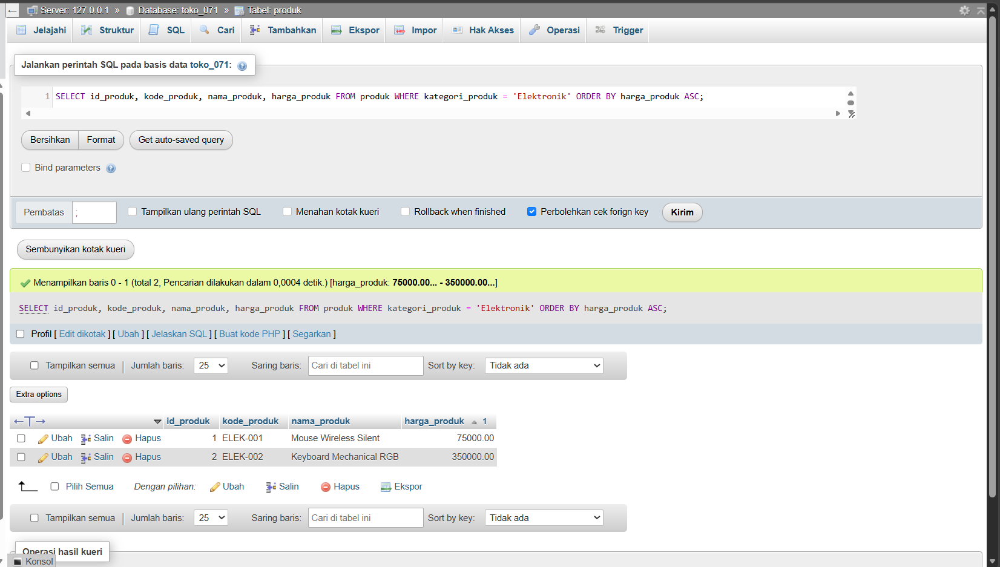
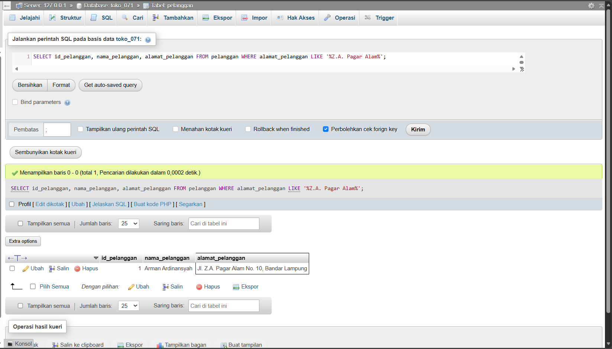
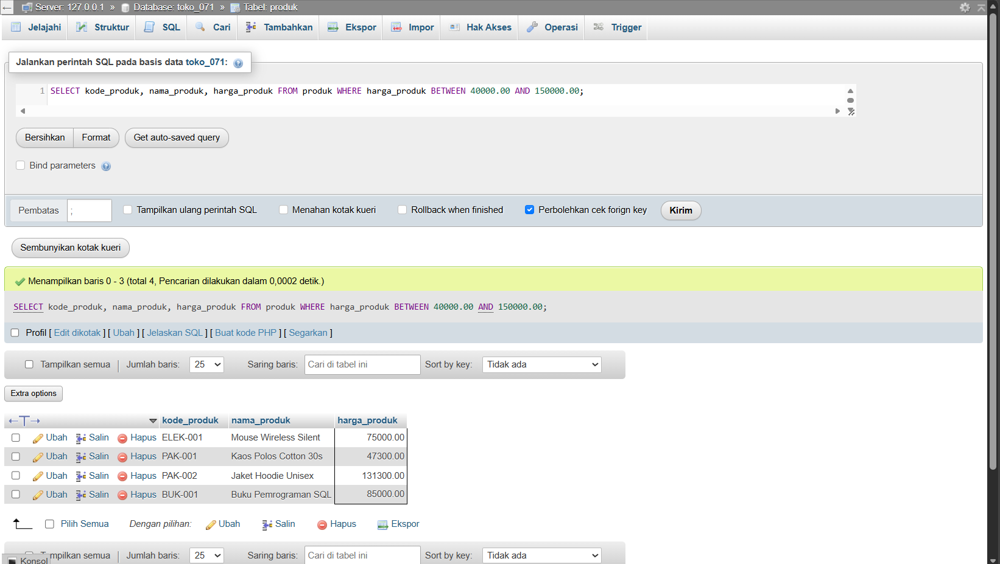
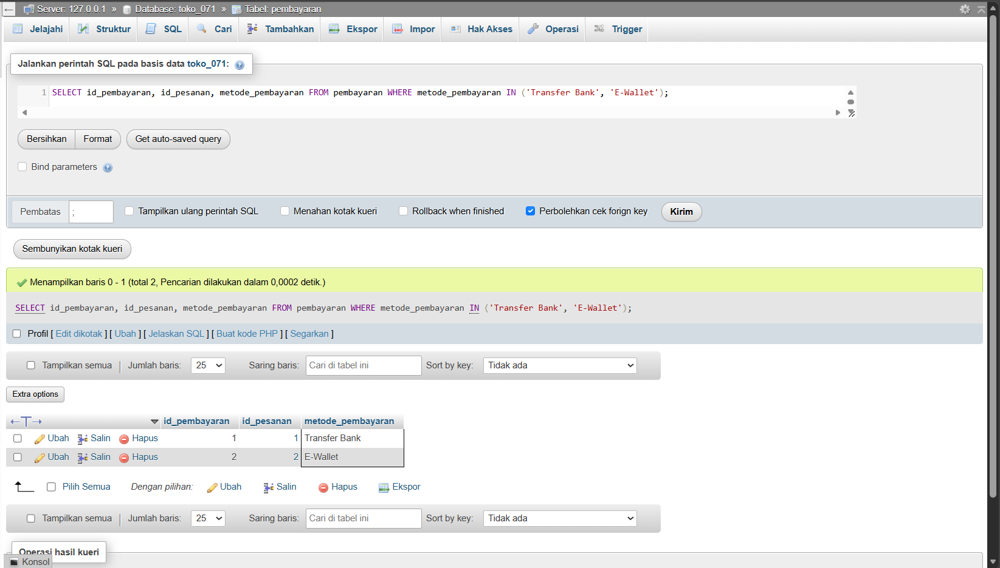
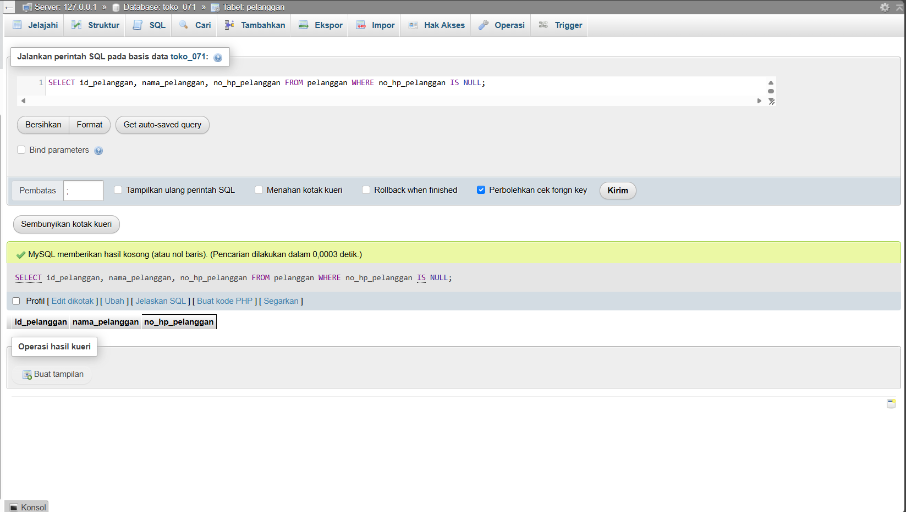
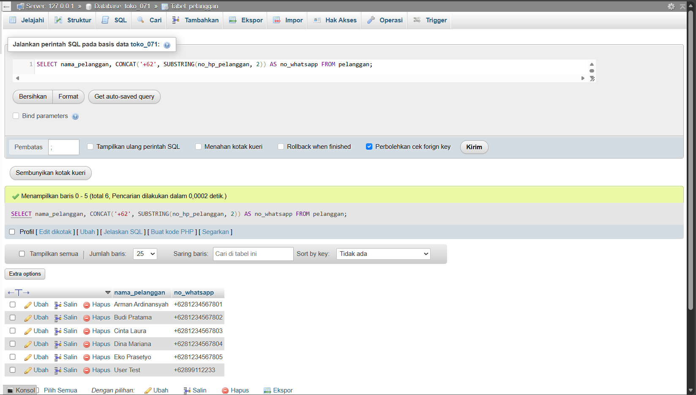
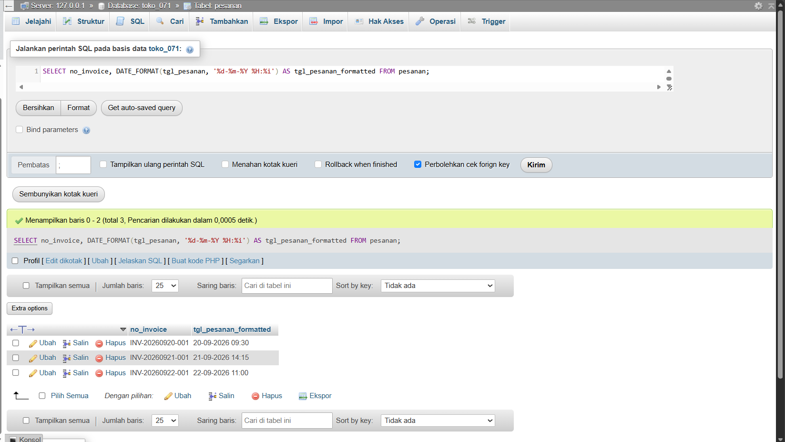
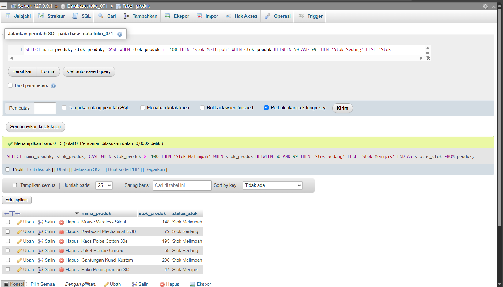
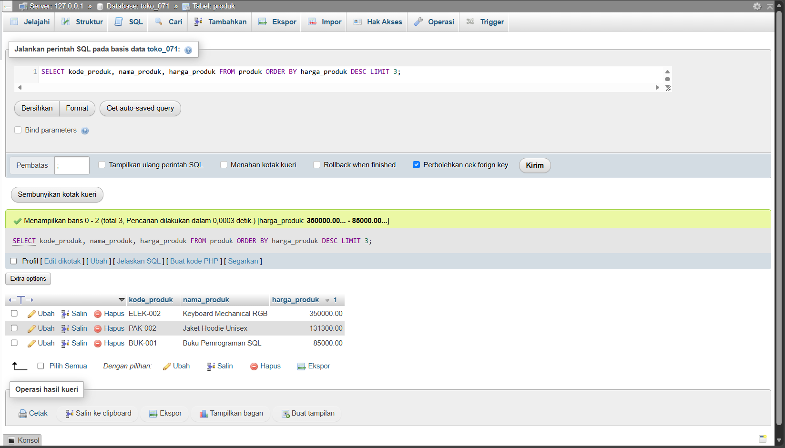
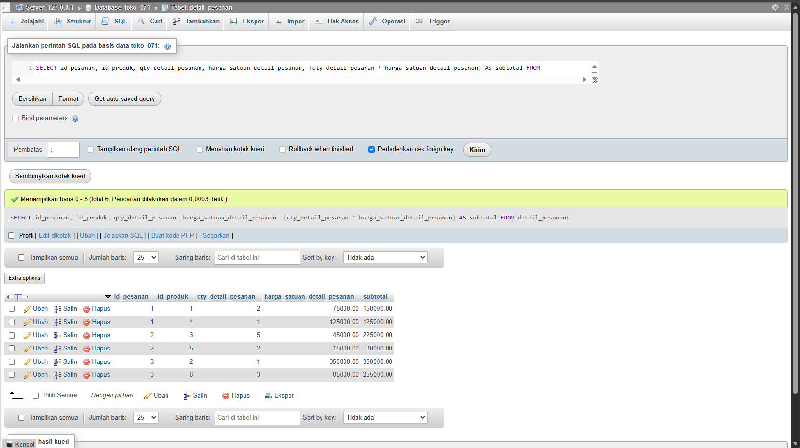

# Laporan Praktikum Basis Data - Pertemuan 07

**Nama:** Arman Ardinansyah   
**NPM:** 25430071   
**Kelas:** C   
**Tanggal:** 10 November 2026  
**Dosen Pengampu:** Dedi Irawan, S.Kom., M.T.I.

---

## 1. Tujuan Praktikum

1. Mahasiswa mampu menulis kueri `SELECT` menggunakan proyeksi kolom, penggunaan alias (`AS`), serta menghilangkan duplikasi data dengan `DISTINCT`.
2. Mahasiswa mampu menyaring baris data menggunakan operator pembanding, logika, `BETWEEN`, `IN`, `LIKE`, dan `IS NULL`.
3. Mahasiswa mampu mengurutkan hasil penyaringan menggunakan `ORDER BY` serta membatasi baris dengan `LIMIT`.
4. Mahasiswa mampu menerapkan fungsi skalar string (`CONCAT`, `SUBSTRING`, `UPPER`), tanggal (`DATE_FORMAT`, `DATEDIFF`), numerik, dan kondisional (`CASE`, `IFNULL`) sesuai kebutuhan informasi.

---

## 2. Ringkasan Dasar Teori

Kueri `SELECT` merupakan perintah utama Data Query Language (DQL) pada basis data relasional yang berfungsi untuk mengambil data dari satu atau beberapa tabel. 

### Sifat dan Urutan Evaluasi Logika SQL
Meskipun disintaks penulisan diawali oleh klausa `SELECT`, mesin DBMS memproses perintah SQL dalam urutan logika sebagai berikut:
1. `FROM`: Menentukan tabel sumber data.
2. `WHERE`: Menyaring baris data berdasarkan kondisi kriteria tertentu.
3. `GROUP BY`: Mengelompokkan baris data (jika ada).
4. `HAVING`: Menyaring kelompok data (jika ada).
5. `SELECT`: Memproyeksikan kolom, kalkulasi ekspresi, dan menetapkan nama alias (`AS`).
6. `ORDER BY`: Mengurutkan baris hasil eksekusi (`ASC` atau `DESC`).
7. `LIMIT`: Membatasi jumlah baris yang ditampilkan.

### Penanganan Nilai `NULL`
Di dalam SQL, `NULL` menyatakan ketiadaan nilai (*unknown value*). Oleh karena itu, operasi pembandingan langsung menggunakan `=` atau `!=` terhadap `NULL` akan selalu menghasilkan logika `UNKNOWN` (dianggap *false* oleh klausa `WHERE`). Evaluasi keberadaan `NULL` wajib menggunakan operator `IS NULL` atau `IS NOT NULL`.

---

## 3. Hasil Langkah Percobaan

Berikut adalah bukti eksekusi perintah SQL pada Proyek Terpandu (`kopma_071`):

### D.1 Proyeksi dan Penyaringan

1. **KI-03: Barang di bawah stok minimum**
   ```sql
   SELECT kode_barang, nama_barang, stok_barang, stok_min_barang, 
          stok_min_barang - stok_barang AS kurang
   FROM barang
   WHERE stok_barang < stok_min_barang
   ORDER BY kurang DESC;
   ```


2. **Penyaringan dengan Operator `IN`, `BETWEEN`, dan `IS NULL`**
   ```sql
   -- a. Kategori ATK atau Minuman (IN)
   SELECT kode_barang, nama_barang, kategori_barang, harga_jual_barang
   FROM barang
   WHERE kategori_barang IN ('ATK', 'Minuman');

   -- b. Rentang Tanggal Penjualan September 2026 (BETWEEN)
   SELECT no_penjualan, tgl_penjualan, total_penjualan
   FROM penjualan
   WHERE tgl_penjualan BETWEEN '2026-09-01 00:00:00' AND '2026-09-30 23:59:59';

   -- c. Anggota tanpa Nomor HP (IS NULL)
   SELECT no_anggota, nama_anggota, status_anggota
   FROM anggota
   WHERE no_hp_anggota IS NULL;
   ```

---

### D.2 Pola Teks dan Nilai Kosong

3. **Pencarian Pola Huruf dan Format Label**
   ```sql
   SELECT CONCAT(nama_anggota, ' (', no_anggota, ')')       AS anggota,
          DATE_FORMAT(tgl_daftar_anggota, '%d-%m-%Y')          AS tgl_daftar_anggota,
          IFNULL(no_hp_anggota, '-')                           AS hp,
          CASE status_anggota WHEN 'aktif' THEN 'Diskon 5%'
                      ELSE 'Tanpa diskon' END                  AS keterangan
   FROM anggota
   WHERE nama_anggota LIKE '%a%'
   ORDER BY tgl_daftar_anggota DESC
   LIMIT 5;
   ```

---

### D.3 Tanggal dan Perhitungan per Baris

4. **Kalkulasi Lama Keanggotaan dan Kategori**
   ```sql
   SELECT no_anggota, nama_anggota, tgl_daftar_anggota,
          DATEDIFF(CURRENT_DATE, tgl_daftar_anggota) AS lama_anggota_hari,
          CASE 
              WHEN DATEDIFF(CURRENT_DATE, tgl_daftar_anggota) < 180 THEN 'baru'
              ELSE 'lama'
          END AS kategori_keanggotaan
   FROM anggota;
   ```

5. **Rincian Subtotal Nota `PJ-2609-0142`**
   ```sql
   SELECT no_penjualan, kode_barang, qty_detail_penjualan, harga_satuan_detail_penjualan,
          (qty_detail_penjualan * harga_satuan_detail_penjualan) AS subtotal
   FROM detail_penjualan
   WHERE no_penjualan = 'PJ-2609-0142';
   ```

---

## 4. Jawaban Titik Analisis

### Titik Analisis 1
* **Pesan Galat Saat `ORDER BY kurang` Diganti `WHERE kurang > 0`:**  
  `ERROR 1054 (42S22): Unknown column 'kurang' in 'where clause'`
* **Penjelasan Urutan Evaluasi Logika SQL:**  
  Berdasarkan urutan eksekusi logika mesin SQL, klausa `WHERE` diproses **sebelum** klausa `SELECT`. Karena alias kolom `kurang` baru didefinisikan dan diproyeksikan pada tahap `SELECT`, klausa `WHERE` belum mengenali nama alias tersebut sehingga terjadi galat *unknown column*. Sementara itu, klausa `ORDER BY` dievaluasi **setelah** `SELECT`, sehingga `ORDER BY kurang` berhasil dijalankan.
* **Penulisan Syarat Setara Tanpa Alias:**  
  Dapat ditulis dengan mengulang ekspresi perhitungan secara langsung pada klausa `WHERE`:
  ```sql
  WHERE (stok_min_barang - stok_barang) > 0
  ```

### Titik Analisis 2
* **Alasan `WHERE no_hp_anggota = NULL` Tidak Mengembalikan Baris Data:**  
  Dalam basis data relasional, `NULL` mewakili *unknown value* (nilai tak diketahui). Berdasarkan aturan *three-valued logic* (TRUE, FALSE, UNKNOWN), setiap pembandingan nilai dengan `NULL` menggunakan operator pembanding biasa (`=`, `!=`, `<`, `>`) akan menghasilkan nilai `UNKNOWN`. Karena klausa `WHERE` hanya meloloskan baris bernilai `TRUE`, maka tidak ada baris yang dikembalikan.
* **Kueri yang Benar:**  
  ```sql
  SELECT * FROM anggota WHERE no_hp_anggota IS NULL;
  ```
* **Perbedaan `NULL` dengan String Kosong `''`:**  
  * `NULL`: Menunjukkan ketidakadaan data (absen dari memori / nilai belum diisi).
  * String Kosong `''`: Merupakan nilai teks nyata berupa karakter string dengan panjang *zero* (0).

---

## 5. Hasil Latihan dan Modifikasi

Pada sesi latihan, dilakukan pembuatan kueri penyaringan tambahan menggunakan ekspresi kondisional `CASE` untuk membuat label kategori harga barang pada tabel `barang`:

```sql
SELECT kode_barang, nama_barang, harga_jual_barang,
       CASE 
           WHEN harga_jual_barang >= 20000 THEN 'Mahal'
           WHEN harga_jual_barang BETWEEN 10000 AND 19999 THEN 'Sedang'
           ELSE 'Murah'
       END AS kategori_harga
FROM barang
ORDER BY harga_jual_barang DESC;
```

---

## 6. Tugas Mandiri: Milestone Proyek 7

Pada tugas mandiri ini, dieksekusi berkas skrip `p07_kueri_25430071.sql` yang berisi 10 kueri `SELECT` satu tabel pada basis data Toko Daring (`toko_071`):

### 1. Pemetaan Kueri terhadap Kebutuhan Informasi (KI)

* **[KI-01] Menampilkan Produk Elektronik Termurah**
  * Kueri: `SELECT id_produk, kode_produk, nama_produk, harga_produk FROM produk WHERE kategori_produk = 'Elektronik' ORDER BY harga_produk ASC;`
  * 
* **[KI-02] Pencarian Pelanggan Area 'Z.A. Pagar Alam' (`LIKE`)**
  * Kueri: `SELECT id_pelanggan, nama_pelanggan, alamat_pelanggan FROM pelanggan WHERE alamat_pelanggan LIKE '%Z.A. Pagar Alam%';`
  * 
* **[KI-03] Filter Harga Produk Rentang Rp 40.000 - Rp 150.000 (`BETWEEN`)**
  * Kueri: `SELECT kode_produk, nama_produk, harga_produk FROM produk WHERE harga_produk BETWEEN 40000.00 AND 150000.00;`
  * 
* **[KI-04] Filter Metode Pembayaran (`IN`)**
  * Kueri: `SELECT id_pembayaran, id_pesanan, metode_pembayaran FROM pembayaran WHERE metode_pembayaran IN ('Transfer Bank', 'E-Wallet');`
  * 
* **[KI-05] Pencarian Data Pelanggan Kosong (`IS NULL`)**
  * Kueri: `SELECT id_pelanggan, nama_pelanggan, no_hp_pelanggan FROM pelanggan WHERE no_hp_pelanggan IS NULL;`
  * 
* **[KI-06] Format Nomor WhatsApp (`CONCAT` & `SUBSTRING`)**
  * Kueri: `SELECT nama_pelanggan, CONCAT('+62', SUBSTRING(no_hp_pelanggan, 2)) AS no_whatsapp FROM pelanggan;`
  * 
* **[KI-07] Format Tanggal Transaksi Indonesia (`DATE_FORMAT`)**
  * Kueri: `SELECT no_invoice, DATE_FORMAT(tgl_pesanan, '%d-%m-%Y %H:%i') AS tgl_pesanan_formatted FROM pesanan;`
  * 
* **[KI-08] Pengelompokan Ketersediaan Stok (`CASE`)**
  * Kueri: `SELECT nama_produk, stok_produk, CASE WHEN stok_produk >= 100 THEN 'Stok Melimpah' WHEN stok_produk BETWEEN 50 AND 99 THEN 'Stok Sedang' ELSE 'Stok Menipis' END AS status_stok FROM produk;`
  * 
* **[KI-09] Produk Termahal Top 3 (`LIMIT`)**
  * Kueri: `SELECT kode_produk, nama_produk, harga_produk FROM produk ORDER BY harga_produk DESC LIMIT 3;`
  * 
* **[KI-10] Perhitungan Subtotal Item Detail Pesanan (Aritmatika)**
  * Kueri: `SELECT id_pesanan, id_produk, qty_detail_pesanan, harga_satuan_detail_pesanan, (qty_detail_pesanan * harga_satuan_detail_pesanan) AS subtotal FROM detail_pesanan;`
  * 

### 2. Penjelasan Keputusan Desain dan Fungsi Skalar
1. **Penggunaan `CONCAT` & `SUBSTRING` pada KI-06**: Dipilih untuk mengonversi format awalan nomor telepon lokal `08...` menjadi penulisan standar internasional `+628...` demi kebutuhan integrasi gateway pesan WhatsApp.
2. **Penggunaan `DATE_FORMAT` pada KI-07**: Mengubah tampilan default format tanggal SQL (`YYYY-MM-DD HH:MM:SS`) menjadi format ramah pengguna Indonesia (`DD-MM-YYYY HH:mm`).
3. **Penandaan KI Multi-Tabel**: KI-11 (Mencari nama pelanggan berdasarkan nomor invoice) dan KI-12 (Mencari nama produk dan nama kurir per transaksi) ditandai di skrip SQL sebagai kueri yang belum dapat dijawab 1 tabel dan akan diselesaikan menggunakan klausa `JOIN` pada Pertemuan 9-12.

---

## 7. Pembahasan dan Kendala

### Kendala yang Ditemui

Pada awal pengerjaan, layanan MySQL pada XAMPP mengalami kegagalan saat dijalankan melalui XAMPP Control Panel. Muncul pesan kesalahan sebagai berikut:

`Error: MySQL shutdown unexpectedly. This may be due to a blocked port, missing dependencies, improper privileges, a crash, or a shutdown by another method.`

Akibat kendala tersebut, layanan MySQL tidak dapat berjalan sehingga phpMyAdmin tidak bisa digunakan untuk mengakses dan mengelola basis data.

### Cara Membaca dan Diagnosis Galat

Setelah dilakukan pemeriksaan melalui Command Prompt (CMD), diketahui bahwa tidak terdapat proses MySQL yang sedang berjalan dan port 3306 tidak sedang digunakan oleh aplikasi lain.

Selanjutnya, dilakukan pemeriksaan log MariaDB dengan menjalankan server secara manual. Hasil pemeriksaan menunjukkan adanya masalah pada pembacaan metadata replikasi (*replication metadata*), khususnya pada berkas `multi-master.info`.

Log menampilkan beberapa pesan kesalahan terkait entri informasi master yang kosong (*empty master connection name*) dan kegagalan menambahkan informasi tersebut ke dalam struktur *master_info*. Hal ini menyebabkan proses inisialisasi MariaDB dihentikan (*aborting*).

Berdasarkan hasil diagnosis tersebut, masalah diduga berasal dari metadata replikasi yang bermasalah, bukan kerusakan pada berkas utama penyimpanan InnoDB seperti `ibdata1` atau `ib_logfile`.

### Solusi dan Cara Mengatasi

Langkah-langkah yang dilakukan untuk mengatasi permasalahan tersebut adalah sebagai berikut:

1. Memastikan tidak terdapat proses `mysqld.exe` yang masih berjalan melalui Command Prompt.
2. Melakukan pencadangan (*backup*) seluruh folder `C:\xampp\mysql\data` ke lokasi lain, yaitu `D:\backupdataxampp`, untuk menjaga keamanan basis data yang telah dibuat sebelumnya.
3. Membuka Command Prompt dengan hak akses Administrator (*Run as Administrator*).
4. Masuk ke direktori `C:\xampp\mysql\data` dan memeriksa keberadaan berkas `multi-master.info`.
5. Mengganti nama (*rename*) berkas `multi-master.info` menjadi `multi-master.info.bak` tanpa menghapus berkas aslinya.
6. Menjalankan MariaDB secara manual melalui Command Prompt menggunakan perintah:

   `mysqld.exe --defaults-file="C:\xampp\mysql\bin\my.ini" --console`

7. Memeriksa hasil proses startup hingga muncul pesan `mysqld.exe: ready for connections`, yang menandakan bahwa layanan MariaDB berhasil dijalankan pada port 3306.
8. Menjalankan Apache melalui XAMPP Control Panel, kemudian mengakses phpMyAdmin melalui browser untuk memastikan basis data dapat diakses kembali.

### Hasil Penyelesaian

Setelah dilakukan penggantian nama pada berkas metadata `multi-master.info`, layanan MariaDB berhasil dijalankan kembali tanpa melakukan penggantian folder `data` maupun perubahan terhadap berkas penyimpanan utama InnoDB.

Basis data yang sebelumnya telah dibuat, termasuk `db_ojek_pangkalan` dan `db_pusat_kebugaran`, dapat ditemukan kembali melalui phpMyAdmin. Dengan demikian, permasalahan utama pada layanan MySQL berhasil diatasi tanpa perlu melakukan instalasi ulang XAMPP atau menghapus basis data yang sudah tersedia.

---

## 8. Kesimpulan

1. Kueri `SELECT` satu tabel memungkinkan penyaringan data yang presisi menggunakan gabungan operator pembanding (`BETWEEN`, `IN`, `LIKE`) dan pembatas `LIMIT`.
2. Pemahaman terhadap urutan evaluasi logika SQL (khususnya perbedaan tahap pemrosesan `WHERE` dan `SELECT`) sangat krusial untuk menghindari galat pembacaan nama alias kolom.
3. Fungsi skalar string (`CONCAT`), tanggal (`DATE_FORMAT`), dan kondisional (`CASE`, `IFNULL`) mempermudah penyajian data agar lebih informatif dan siap dikonsumsi oleh pengguna/aplikasi antarmuka.

---

## 9. Pernyataan Penggunaan AI

Penggunaan AI dalam praktikum pertemuan ini hanya dimanfaatkan sebagai alat bantu diskusi dan perapian format dokumentasi, yaitu:
- Diskusi logika penyusunan sintaks kueri `SELECT` dan pemahaman fungsi skalar SQL (seperti `DATE_FORMAT`, `DATEDIFF`, dan `CASE`).
- Membantu menganalisis penyebab galat `ERROR 1054` pada Titik Analisis 1 terkait urutan evaluasi klausa `WHERE` dan `ORDER BY`.
- Pengecekan dan perapian struktur dokumen Markdown laporan agar sesuai dengan kriteria checklist praktikum.

Seluruh eksekusi skrip SQL di MariaDB/phpMyAdmin, pengujian data, dan pengambilan bukti tangkapan layar dilakukan secara mandiri.

---

## 10. Bukti Git

* **Tautan Repositori:** `https://github.com/armanardinansyah05-lab/basisdata-25430071`
* **Hash Commit:** `b758a9a`
* **Pesan Commit:** `p07: kueri kopma`

---

## Checklist Laporan Praktikum

### Checklist Umum (Berlaku di Semua Pertemuan)

- [x] **Identitas:** Nama, NIM, kelas, pertemuan ke-N, tanggal pelaksanaan, nama asisten/dosen terisi lengkap.
- [x] **Tujuan:** Tujuan praktikum ditulis ulang dengan bahasa sendiri (maksimal 5 baris).
- [x] **Ringkasan Teori:** Pemahaman sendiri atas Dasar Teori, maksimal setengah halaman, tanpa menyalin buku.
- [x] **Langkah Percobaan (D):** Tangkapan layar hasil langkah kunci sesuai checklist khusus, masing-masing diberi keterangan singkat.
- [x] **Titik Analisis:** Semua Titik Analisis dijawab lengkap dengan alasan, bukan sekadar ya/tidak.
- [x] **Latihan (E):** Skrip/dokumen hasil latihan beserta bukti berjalan disajikan.
- [x] **Tugas Mandiri (F):** Milestone proyek pertemuan ini: berkas, bukti, dan penjelasan keputusan desain terlampir.
- [x] **Pembahasan dan Kendala:** Galat yang ditemui, cara membacanya, dan cara mengatasinya dijelaskan.
- [x] **Kesimpulan:** Dua sampai empat kalimat dengan bahasa sendiri disajikan.
- [x] **Pernyataan Penggunaan AI:** Alat yang dipakai, untuk apa, bagian mana dituliskan dengan jujur.
- [x] **Bukti Git:** Tautan repositori dan kode *commit* (hash) pertemuan ini dengan pesan `p07: ...` dicantumkan.
- [x] **Keaslian:** Setiap tangkapan layar memperlihatkan akun ber-NIM dan jam sistem/nama objek memuat NIM.

### Checklist Khusus Pertemuan 7

- [x] **Berkas wajib:** `p07_kueri_25430071.sql` berisi minimal 10 kueri satu tabel, masing-masing diberi komentar KI dan hasil yang diharapkan.
- [x] **Bukti tangkapan layar:** Tangkapan layar hasil dari eksekusi setiap kueri dilampirkan secara rapi.
- [x] **Analisis wajib:** Pemetaan kueri ke KI serta alasan pemilihan fungsi skalar yang dipakai dijelaskan secara rinci.